<!-- TEST_RESULTS_START -->
Guia de Execução do Projeto
============================

Pré-requisitos
--------------
- Docker e Docker Compose
- Python 3.12+ e pip
- Node.js 20+ e npm
- Ollama com os modelos desejados
- Tesseract OCR

Configuração de Variáveis de Ambiente
--------------------------------------
Crie um arquivo `.env` na raiz do projeto com as variáveis abaixo.
Um exemplo pronto está disponível em `.env.example`.

- OLLAMA_API_KEY=chave_principal,chave_reserva
- OLLAMA_HOST=https://ollama.com
- OLLAMA_AVAILABLE_MODELS=gemma4:cloud,gpt-oss:120b,nemotron-3-ultra
- OLLAMA_VISION_MODELS=gemma4:cloud
- OLLAMA_FREE_MODELS=
- OLLAMA_MAX_TOKENS=16000
- OLLAMA_REQUEST_TIMEOUT=600
- OLLAMA_MAX_RETRIES=3
- DEFAULT_MODEL=gemma4:cloud

- OPENAI_API_KEY=, chave da OpenAI (pool fallback para usuários sem chave)
- OPENAI_MODELS=
- GROQ_API_KEY=, chave da Groq (pool fallback para usuários sem chave)
- GROQ_MODELS=
- GEMINI_API_KEY=, chave da Gemini (pool fallback para usuários sem chave)
- GEMINI_MODELS=
- OPENROUTER_API_KEY=, chave da OpenRouter (pool fallback para usuários sem chave)
- OPENROUTER_MODELS=
- DEEPSEEK_API_KEY=, chave da DeepSeek (pool fallback para usuários sem chave)
- DEEPSEEK_MODELS=
- ANTHROPIC_API_KEY=, chave da Anthropic (pool fallback para usuários sem chave)
- ANTHROPIC_MODELS=
- NVIDIA_API_KEY=, chave da NVIDIA (pool fallback para usuários sem chave)
- NVIDIA_MODELS=

- RAG_SERVICE_URL=http://llm_api:8001
- RAG_SIMILARITY_THRESHOLD=0.60
- RAG_N_RESULTS=12
- REFINEMENT_INTERACTIONS=3

- OCR_SPACE_API_KEY=key
- OCR_SPACE_CONNECT_TIMEOUT=10
- OCR_SPACE_READ_TIMEOUT=30
- OCR_SPACE_MAX_FAILURES=3
- OCR_SPACE_MAX_PAGES=500
- OCR_MAX_WORKERS=16
- OCR_DPI=200
- UPLOAD_MAX_FILES=100
- OFFICE_CONVERSION_TIMEOUT=300

- INDEX_CHUNK_TARGET_SIZE=500
- INDEX_CHUNK_OVERLAP=80
- INDEX_BATCH_SIZE=100
- INDEX_MAX_WORKERS=4

- ANALYZE_TEMPERATURE_WITH_RAG=0.0
- ANALYZE_TEMPERATURE_WITHOUT_RAG=0.0
- GEN_TEMPERATURE_GENERIC=0.0

- HF_TOKEN=hf_seu_token_huggingface

- EMAIL_HOST=smtp.gmail.com
- EMAIL_HOST_USER=usuario@gmail.com
- EMAIL_HOST_PASSWORD=xxxxxxxxxxx
- EMAIL_PORT=587
- EMAIL_USE_TLS=True
- EMAIL_FROM=usuario@gmail.com
- FRONTEND_URL=http://localhost:3000
- RESET_TOKEN_MINUTES=30

- SECRET_KEY=troque_por_uma_chave_aleatoria_longa

- AUTH_LOGIN_MAX_TENTATIVAS=5
- AUTH_LOGIN_JANELA_MIN=15
- AUTH_CADASTRO_MAX=5
- AUTH_CADASTRO_JANELA_H=1
- AUTH_RESET_MAX=5
- AUTH_RESET_JANELA_H=1

Variáveis opcionais do runner de testes (readme.py):
- TEST_RAG_SIMILARITY_THRESHOLD (default 0.60)
- TEST_RAG_N_RESULTS (default 12)
- TEST_PAIRWISE_DIFF_TEMPS (default 0)
- TEST_AUTO_CONSISTENCY_RUNS (default 3)
- TEST_AUTO_CONSISTENCY_MEDIANA (default 7 — chamadas por execução da auto-consistência)
- TEST_VISION_MODELS_BLOCKLIST (default "gpt-oss:120b,nemotron-3-ultra")
- TEST_FUNCTIONAL_MODELS (default "" — usa todos os disponíveis)
- TEST_EVALUATOR_MODEL (default "gpt-oss:120b")
- TEST_SECONDARY_EVALUATOR (default "nemotron-3-ultra")
- TEST_LOGIN_EMAIL / TEST_LOGIN_PASSWORD

Embedding Multilíngue
---------------------
O sistema usa o modelo `intfloat/multilingual-e5-base` para gerar embeddings
vetoriais. Ele suporta português, inglês e mais de 50 idiomas e requer prefixos
"query:" (consultas) e "passage:" (documentos) para melhor desempenho.

Instalação do Tesseract (Linux)
-------------------------------
sudo apt update
sudo apt install tesseract-ocr tesseract-ocr-por tesseract-ocr-eng

Como criar o HuggingFace Token (HF_TOKEN)
-----------------------------------------
1. Acesse https://huggingface.co/join e crie uma conta gratuita.
2. Confirme o cadastro pelo e-mail.
3. Faça login em https://huggingface.co/login
4. Acesse https://huggingface.co/settings/tokens
5. Clique em New token.
6. Nome: questions-aplication | Type: Read
7. Clique em Generate a token.
8. Copie o token (formato hf_XXXXX). Ele só é exibido uma vez.
9. Cole no .env: HF_TOKEN=hf_seu_token_aqui
10. Reinicie: docker compose restart llm_api

Estrutura do Projeto
--------------------
- backend/          # Flask
- frontend/         # React
- llm_api/          # FastAPI
- tests/            # Referências de teste
- docker-compose.yml
- README.md

Execução com Docker
-------------------
    docker compose up -d

Execução Local
--------------
Backend:
    cd backend && python app.py

Frontend:
    cd frontend && npm start

API de IA:
    cd llm_api && uvicorn main:app --host 0.0.0.0 --port 8001

Credenciais de Teste
--------------------
- Email: yago.costa@aluno.uece.br
- Senha: yago1234

Sondagem de Modelos (Health Check)
---------------------------------
O endpoint `GET /models` sonda a saúde de cada modelo antes de
expor no seletor: uma chamada mínima de chat completion (`max_tokens=1`)
marca o modelo como testado, falhou ou transitório. Modelos com falha
definitiva ficam fora do seletor. O resultado é cacheado por fingerprint
de chave (TTL 15 minutos; 60 quando a última sonda foi inconclusiva).
Falhas transitórias não descartam o modelo (fail-open por grupo).

Provedores Externos
-------------------
Modelos de OpenAI, Groq, Google Gemini, OpenRouter, DeepSeek, Anthropic e
NVIDIA são servidos via adapters compatíveis (chat completions e, no caso
da Anthropic, `/v1/messages`). As chaves de usuário ficam no mesmo campo
`user.ollama_keys` (formato `provedor=chave`). Os pools do `.env`
(`OPENAI_API_KEY`, `GROQ_API_KEY`, `GEMINI_API_KEY`, `OPENROUTER_API_KEY`,
`DEEPSEEK_API_KEY`, `ANTHROPIC_API_KEY`, `NVIDIA_API_KEY`) são usados como
fallback quando o usuário não tem chave do provedor. O modelo padrão é
escolhido de forma context-aware (`ollama_client.padrao_para_o_usuario`).

Quadro Branco
-------------
O quadro branco segue o tema do aplicativo (contexto de tema) e não possui
toggle próprio. O fundo do canvas acompanha o tema (branco no claro, escuro
no escuro). O PNG do composto salvo tem o fundo "assado" removido (cores de
fundo conhecidas viram transparência) e o fundo do tema atual é reaplicado
ao carregar. Salvamentos automáticos ignoram estados de fundo/carregamento.

Escala de Avaliação
-------------------
Todas as avaliações usam escala INTEIRA de 1 a 10. Zero não é permitido.
- 1-3: resposta fraca/incorreta
- 4-5: resposta parcial
- 6-7: resposta mediana a boa
- 8-9: resposta boa a muito boa
- 10: resposta excelente

Modelos Avaliadores
-------------------
- Avaliador primário: gpt-oss:120b
- Avaliador secundário (fallback): nemotron-3-ultra
- Modelo com visão: gemma4:cloud
- Modelo somente texto: gpt-oss:120b

Filtro de Modelos de Visão
--------------------------
Modelos sem suporte a imagem são excluídos automaticamente dos testes que
enviam imagens. A lista é configurável via TEST_VISION_MODELS_BLOCKLIST
(default: gpt-oss:120b,:nemotron-3-ultra). Modelos listados são removidos de:
- Avaliação pareada (evaluate_models)
- Benchmark de tempo (benchmark_models)
- Teste de impacto do RAG (test_rag_impact)
- Testes de endpoints e funcionalidades que dependem de visão

Benchmark Dual de Modelos
-------------------------
O benchmark de tempo é executado em DOIS modos:
1. VISAO (com imagem): apenas modelos avaliados que suportam visão.
   Envia uma imagem sintética via /analyze_with_image.
2. TEXTO (sem imagem): apenas os modelos avaliados. Envia um prompt
   textual via /generate (no_rag=True).
Os juízes (gpt-oss:120b, nemotron-3-ultra) ficam fora dos dois modos, porque
são eles que pontuam os modelos — medir os juízes aqui enviesaria a comparação.
O gráfico `images/bar_chart_models.png` mostra os dois modos lado a lado.

Isolamento do Juiz (no_rag=True)
--------------------------------
Todas as chamadas ao juiz (avaliação pareada e RAG impact) usam no_rag=True, que
faz o llm_api ignorar o retrieval do Chroma e não injetar exemplos.

Tópicos de Teste Dual (Funcionalidades)
---------------------------------------
Para cada funcionalidade que usa RAG, os testes são executados DUAS VEZES:

1. Em 'TesteTemp_sem_rag': imagens sintéticas SEM o PDF (RAG vazio).
2. Em 'TesteTemp_com_rag': imagens sintéticas COM os chunks do PDF replicados.

Reuso do PDF de Referência (cache em disco + tópico template)
-------------------------------------------------------------
O PDF de referência é OCRizado e indexado apenas UMA VEZ. Os chunks resultantes
são salvos em `tests/rag_cache_v9-gptoss-judge-gemma-functional_<md5>.json`. O cache é invalidado
quando o MD5 do PDF muda OU quando a CACHE_VERSION muda. A versão atual é:
CACHE_VERSION=v9-gptoss-judge-gemma-functional. Incremente essa constante sempre que alterar
a lógica de extração do PDF ou de chunking.

Extração de PDF em Duas Colunas
-------------------------------
O backend detecta automaticamente PDFs multi-coluna via PyMuPDF (`get_text("blocks")`)
e reconstrói a ordem de leitura (coluna esquerda inteira, depois direita), evitando
que o texto do sumário e do corpo sejam intercalados. Páginas identificadas como
TOC (muitos `.` seguidos de página) ou capa são descartadas da indexação, assim
como chunks com baixo sinal semântico.

Filtro de Similaridade e Diagnóstico de Ranking (llm_api/main.py)
------------------------------------------------------------------
O endpoint /retrieve_context aplica um filtro real de similaridade antes de
montar o contexto. O threshold default do runner é 0.72. Ajuste via
TEST_RAG_SIMILARITY_THRESHOLD. O endpoint também descarta chunks inúteis (TOC,
capa, baixo sinal) via `is_usable_chunk`, além de permitir `exclude_source`
para descartar self-matches (chunks cujo source == nome da imagem atual).

Diagnóstico de Aliasing entre Modelos
-------------------------------------
O script verifica via /api/show se os modelos têm modelfile_hash distintos e
executa um probe com nonce para medir diversidade real de geração.

Juiz de Avaliação (Retry Robusto, Clamping e Mediana)
-------------------------------------------------------
O juiz usa até 3 tentativas com prompts progressivamente diferentes e, se
falhar, tenta extrair notas via prosa, tabela markdown e re-extração via LLM
secundário. Todas as notas são clampadas para [1, 10].

Cada nota pareada (SEM RAG vs COM RAG) é a MEDIANA de
3 chamadas independentes do juiz
(temperature=0.0). A mesma mediana é aplicada às duas respostas, sem qualquer
preferência de direção — o ruído amostral do juiz é reduzido sem viés em favor
do RAG. A auto-consistência da seção 7b também mede medianas de
3 chamadas por execução.

Se o contexto RAG estiver vazio, o juiz é instruído a avaliar pelo mérito
intrínseco das respostas, sem penalizar por material ausente. Casos em que o
contexto permanece vazio são EXCLUÍDOS da amostra antes da nota (o RAG não
foi exercitado) e reportados como exclusões.

Arquivo de referência em `tests/`:
- Sistemas Operacionais Modernos (Andrew S. Tanenbaum, Herbert Bos).pdf

Banco de questões (gabarito e fontes para citação no TCC/artigo):
- tests/questoes_so.json — questões de SO pesquisadas e verificadas na web,
  cada uma com enunciado, alternativas, gabarito, justificativa e fonte (URL).
- tests/FONTES_questoes_so.md — metodologia de seleção e justificativa das fontes.
- O juiz recebe o enunciado real (judge_question) e o gabarito oficial de cada caso;
  a resposta correta deixa de depender da interpretação do próprio juiz.

Casos avaliados (50):
- so_a01
- so_a02
- so_a03
- so_a04
- so_a05
- so_a06
- so_a07
- so_a08
- so_a09
- so_a10
- so_a11
- so_a12
- so_a13
- so_b01
- so_b02
- so_b03
- so_b04
- so_b05
- so_b06
- so_b07
- so_b08
- so_b09
- so_b10
- so_b11
- so_b12
- so_b13
- so_c01
- so_c02
- so_c03
- so_c04
- so_c05
- so_c06
- so_c07
- so_c08
- so_c09
- so_c10
- so_c11
- so_c12
- so_d01
- so_d02
- so_d03
- so_d04
- so_d05
- so_d06
- so_d07
- so_d08
- so_d09
- so_d10
- so_d11
- so_d12

Testes Automatizados
--------------------
    python readme.py

---
**Avalie o projeto respondendo ao formulário abaixo:**
https://docs.google.com/forms/d/e/1FAIpQLSeU19fj5QZ4zc2Zz6vlycZPlL42yOoRo1VA6q9CLCPq7ftBeg/viewform?usp=sharing&ouid=105919124478207064388

---

Relatório de Testes Automatizados
=================================

Gerado em: 30/09/2026 18:53:36

Visão Geral
-----------
Este relatório documenta os resultados dos testes automatizados de integração do projeto QuestionsAplication.
Todas as avaliações utilizam escala INTEIRA de 1 a 10.

1. Informações do Ambiente de Execução
--------------------------------------
- Diretório base: /home/yago/QuestionsAplication
- Imagens de relatório: images
- Data e hora do relatório: 30/09/2026 18:53:36
- Total de endpoints testados: 18
- Total de páginas/front-end verificadas: 9
- Total de execuções de benchmark: 2
- Threshold de similaridade RAG: 0.72
- RAG_N_RESULTS: 12
- Modelos bloqueados para visão: ['gpt-oss:120b', 'nemotron-3-ultra']
- Cache version (PDF): v9-gptoss-judge-gemma-functional

2. Status dos Serviços
----------------------
| Serviço | Status | HTTP | Tempo (s) |
|---------|--------|------|-----------|
| frontend | online | 200 | 0.001 |
| backend | online | 200 | 0.002 |
| llm_api | online | 200 | 0.002 |

3. Testes de Endpoints da API
-----------------------------
| Endpoint | Status | HTTP | Tempo (s) |
|----------|--------|------|-----------|
| GET /api/topics | OK | 200 | 0.005 |
| POST /api/topics (criar TesteTemp) | OK | 200 | 0.004 |
| GET /api/topics/TesteTemp | OK | 200 | 0.010 |
| POST /analyze_with_image (em TesteTemp) | OK | 200 | 24.684 |
| POST /save_example (em TesteTemp) | OK | 200 | 0.119 |
| GET /api/models | OK | 200 | 0.003 |
| GET llm_api/health | OK | 200 | 0.002 |
| GET llm_api/models | OK | 200 | 0.002 |
| POST llm_api/index | OK | 200 | 0.002 |
| POST /generate_questions (em TesteTemp) | OK | 200 | 4.904 |
| POST /generate_flashcards (em TesteTemp) | OK | 200 | 36.109 |
| POST /save_answers (em TesteTemp) | OK | 200 | 0.037 |
| GET /topic/TesteTemp/sessions | OK | 200 | 0.005 |
| POST /topic/TesteTemp/study_strategy | OK | 200 | 10.682 |
| GET /topic/TesteTemp/study_strategy | OK | 200 | 0.005 |
| POST llm_api/extract_link | OK | 200 | 0.361 |
| POST /save_whiteboard (em TesteTemp) | OK | 200 | 0.013 |
| POST /search_articles | OK | 200 | 3.919 |

Gráfico de Status dos Endpoints
-------------------------------
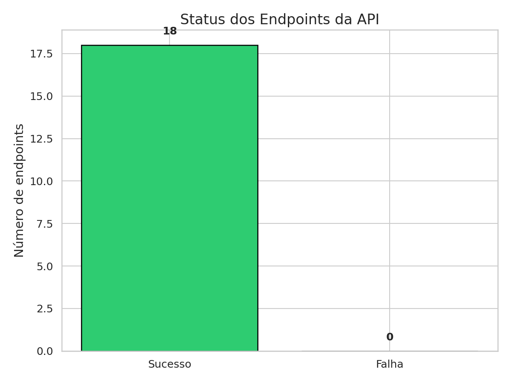

Gráfico de Tempos de Resposta por Endpoint
------------------------------------------
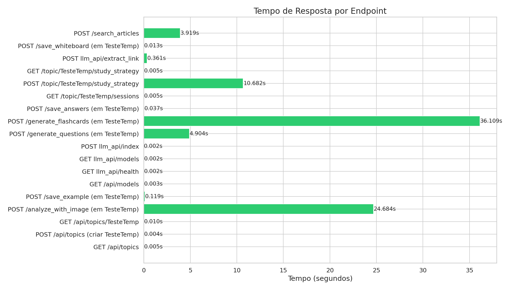

4. Teste de Carga
-----------------
| Métrica | Valor |
|---------|-------|
| Requisições | 50 |
| Sucesso | 50 (100.0%) |
| Tempo médio | 0.024 s |
| Tempo mínimo | 0.008 s |
| Tempo máximo | 0.037 s |
| P95 | 0.036 s |

Distribuição dos Tempos de Resposta
-----------------------------------
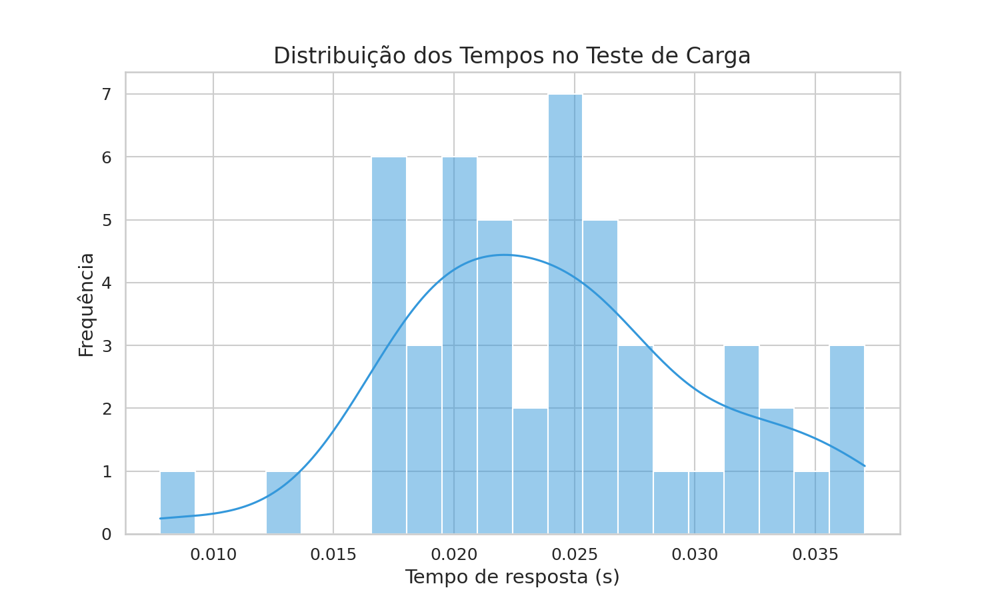

5. Testes do Frontend
---------------------
| Página | Status | HTTP | Tempo (s) |
|--------|--------|------|-----------|
| Homepage | OK | 200 | 0.001 |
| Página de tópico | OK | 200 | 0.001 |
| CSS principal | OK | 200 | 0.001 |
| Upload de imagens (rota) | OK | 200 | 0.003 |
| Upload RAG | OK | 200 | 0.003 |
| Arquivo JavaScript principal | OK | 200 | 0.001 |
| Manifest | OK | 200 | 0.001 |
| Favicon | OK | 200 | 0.001 |
| Upload de PDF | OK | 200 | 0.005 |

6. Benchmark de Tempo dos Modelos
---------------------------------
O benchmark é executado em DOIS modos:
- **VISAO** (com imagem): modelos avaliados com suporte a imagem, via /analyze_with_image.
- **TEXTO** (sem imagem): modelos avaliados, via /generate (no_rag=True).

Juízes excluídos dos dois modos: gpt-oss:120b, nemotron-3-ultra.

**6.1 Visão (com imagem):**

| Modelo | Tempo (s) | Status |
|--------|-----------|--------|
| gemma4:cloud | 15.047 | OK |

**6.2 Texto (sem imagem):**

| Modelo | Tempo (s) | Status |
|--------|-----------|--------|
| gemma4:cloud | 4.278 | OK |

**Resumo consolidado:**

| Modelo | Modo | Tempo (s) | Status |
|--------|------|-----------|--------|
| gemma4:cloud | vision | 15.047 | OK |
| gemma4:cloud | text | 4.278 | OK |

Gráfico de Tempo por Modelo (Visão vs Texto)
--------------------------------------------
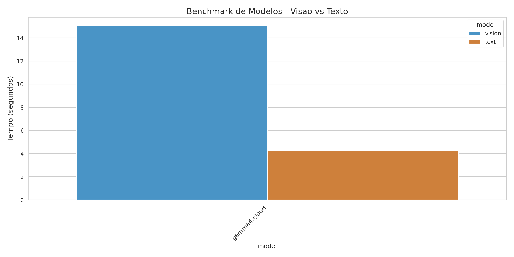

6b. Diagnóstico de Aliasing entre Modelos
------------------------------------------
Modelos distintos no servidor Ollama (por hash): None
Probe de diversidade de geração passou: True

Detalhes por modelo:

**Nota:** O diagnóstico por modelfile_hash foi INCONCLUSIVO.

7. Avaliação de Qualidade (Modelo Único Avaliado)
-------------------------------------------------
Cada resposta foi enviada isoladamente ao juiz, que atribuiu notas absolutas de 1 a 10, sem comparação com outros modelos.
Cada modelo foi executado em um tópico isolado temporário.

temperature=0.0 em todas as respostas. Juiz com no_rag=True.
Modelos bloqueados para visão foram excluídos: ['gpt-oss:120b', 'nemotron-3-ultra'].
Juízes excluídos da avaliação: ['gpt-oss:120b', 'nemotron-3-ultra'].
Modelos avaliados: ['gemma4:cloud'].

| Modelo | Imagem | Precisão | Completude | Clareza | Raciocínio | Tempo (s) |
|--------|--------|----------|------------|---------|------------|-----------|
| gemma4:cloud | synthetic_so_a01.png | 7 | 7 | 8 | 8 | 24.46 |
| gemma4:cloud | synthetic_so_a02.png | 9 | 7 | 8 | 8 | 17.96 |
| gemma4:cloud | synthetic_so_a03.png | 8 | 6 | 8 | 7 | 16.83 |
| gemma4:cloud | synthetic_so_a04.png | 6 | 5 | 7 | 5 | 18.09 |
| gemma4:cloud | synthetic_so_a05.png | 8 | 5 | 8 | 6 | 11.09 |
| gemma4:cloud | synthetic_so_a06.png | 8 | 5 | 7 | 6 | 28.70 |
| gemma4:cloud | synthetic_so_a07.png | 8 | 7 | 8 | 8 | 16.58 |
| gemma4:cloud | synthetic_so_a08.png | 8 | 7 | 8 | 7 | 21.47 |
| gemma4:cloud | synthetic_so_a09.png | 6 | 5 | 8 | 7 | 10.78 |
| gemma4:cloud | synthetic_so_a10.png | 8 | 5 | 7 | 6 | 10.10 |
| gemma4:cloud | synthetic_so_a11.png | 8 | 6 | 8 | 7 | 10.38 |
| gemma4:cloud | synthetic_so_a12.png | 7 | 7 | 8 | 7 | 11.61 |
| gemma4:cloud | synthetic_so_a13.png | 7 | 5 | 8 | 4 | 11.80 |
| gemma4:cloud | synthetic_so_b01.png | 2 | 2 | 5 | 3 | 15.88 |
| gemma4:cloud | synthetic_so_b02.png | 8 | 6 | 8 | 7 | 20.94 |
| gemma4:cloud | synthetic_so_b03.png | 8 | 7 | 8 | 8 | 25.08 |
| gemma4:cloud | synthetic_so_b04.png | 8 | 7 | 8 | 7 | 32.72 |
| gemma4:cloud | synthetic_so_b05.png | 8 | 5 | 7 | 6 | 16.31 |
| gemma4:cloud | synthetic_so_b06.png | 9 | 8 | 9 | 8 | 24.12 |
| gemma4:cloud | synthetic_so_b07.png | 8 | 6 | 8 | 7 | 22.71 |
| gemma4:cloud | synthetic_so_b08.png | 8 | 7 | 8 | 7 | 13.15 |
| gemma4:cloud | synthetic_so_b09.png | 8 | 6 | 8 | 5 | 24.68 |
| gemma4:cloud | synthetic_so_b10.png | 8 | 7 | 8 | 7 | 20.55 |
| gemma4:cloud | synthetic_so_b11.png | 8 | 5 | 7 | 6 | 29.22 |
| gemma4:cloud | synthetic_so_b12.png | 3 | 3 | 5 | 5 | 49.18 |
| gemma4:cloud | synthetic_so_c01.png | 8 | 5 | 7 | 7 | 37.58 |
| gemma4:cloud | synthetic_so_c02.png | 8 | 5 | 8 | 7 | 20.89 |
| gemma4:cloud | synthetic_so_c03.png | 8 | 6 | 8 | 7 | 23.38 |
| gemma4:cloud | synthetic_so_c04.png | 7 | 6 | 7 | 7 | 15.97 |
| gemma4:cloud | synthetic_so_c05.png | 8 | 5 | 7 | 6 | 19.33 |
| gemma4:cloud | synthetic_so_c06.png | 4 | 6 | 5 | 5 | 23.58 |
| gemma4:cloud | synthetic_so_c07.png | 8 | 5 | 8 | 7 | 13.44 |
| gemma4:cloud | synthetic_so_c08.png | 8 | 6 | 8 | 7 | 34.68 |
| gemma4:cloud | synthetic_so_c09.png | 8 | 6 | 8 | 7 | 28.91 |
| gemma4:cloud | synthetic_so_c10.png | 8 | 5 | 8 | 7 | 32.15 |
| gemma4:cloud | synthetic_so_c11.png | 8 | 6 | 7 | 7 | 44.89 |
| gemma4:cloud | synthetic_so_c12.png | 8 | 6 | 8 | 8 | 13.87 |
| gemma4:cloud | synthetic_so_d01.png | 8 | 7 | 8 | 8 | 17.86 |
| gemma4:cloud | synthetic_so_d02.png | 8 | 6 | 8 | 7 | 16.83 |
| gemma4:cloud | synthetic_so_d03.png | 8 | 6 | 8 | 7 | 13.67 |
| gemma4:cloud | synthetic_so_d04.png | 8 | 6 | 8 | 8 | 22.69 |
| gemma4:cloud | synthetic_so_d05.png | 8 | 6 | 8 | 7 | 61.50 |
| gemma4:cloud | synthetic_so_d06.png | 5 | 5 | 7 | 5 | 13.83 |
| gemma4:cloud | synthetic_so_d07.png | 8 | 6 | 8 | 7 | 16.16 |
| gemma4:cloud | synthetic_so_d08.png | 8 | 6 | 8 | 7 | 22.46 |
| gemma4:cloud | synthetic_so_d09.png | 8 | 7 | 8 | 8 | 23.86 |
| gemma4:cloud | synthetic_so_d10.png | 8 | 7 | 8 | 7 | 37.42 |
| gemma4:cloud | synthetic_so_d11.png | 7 | 5 | 7 | 6 | 26.51 |
| gemma4:cloud | synthetic_so_d12.png | 8 | 6 | 8 | 7 | 17.91 |

Médias gerais:
- Precisão: 7.49
- Completude: 5.84
- Clareza: 7.61
- Raciocínio: 6.69

Gráficos:
- Notas por critério e modelo: 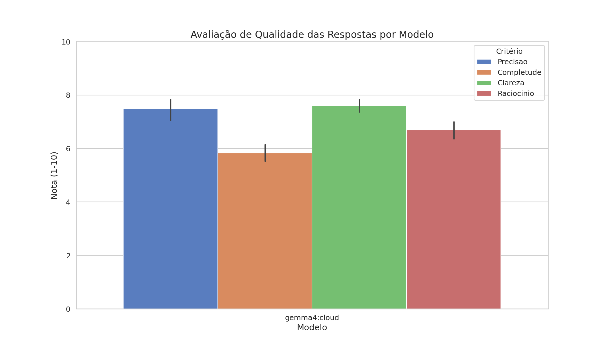
- Médias por modelo: 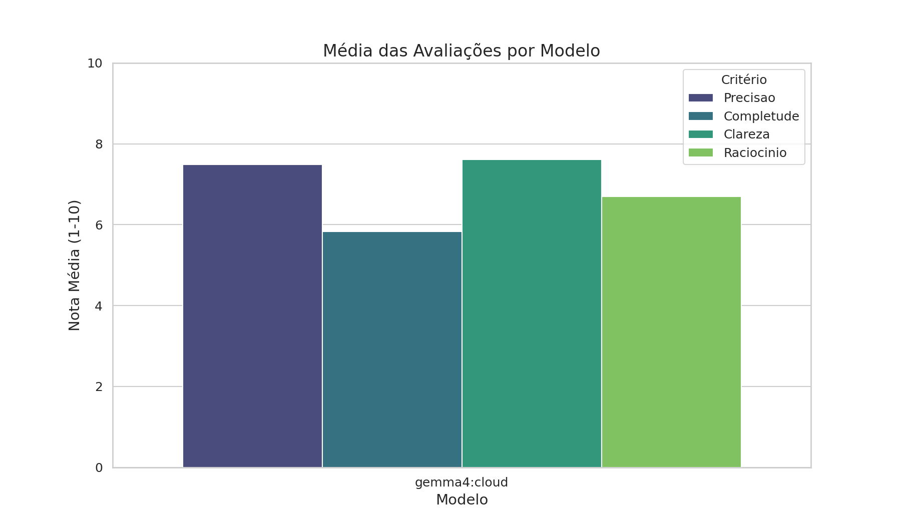

7b. Consistência do Juiz (Auto-Avaliação)
------------------------------------------
Juiz: gpt-oss:120b | Execuções: 3 (mediana de 7 chamadas cada) | Estável: True

| Critério | Valores | Range | Média |
|----------|---------|-------|-------|
| Precisao | [6, 6, 5] | 1 | 5.7 |
| Completude | [3, 3, 3] | 0 | 3.0 |
| Clareza | [6, 6, 6] | 0 | 6.0 |
| Raciocinio | [5, 5, 5] | 0 | 5.0 |

8. Avaliação de Funcionalidades Específicas (COM e SEM RAG)
-----------------------------------------------------------
Cada funcionalidade que usa RAG foi executada DUAS vezes:
1. Em `TesteTemp_sem_rag`: imagens sintéticas SEM o PDF (RAG vazio).
2. Em `TesteTemp_com_rag`: imagens sintéticas COM os chunks do PDF replicados.

**Geração de Questões Personalizadas**
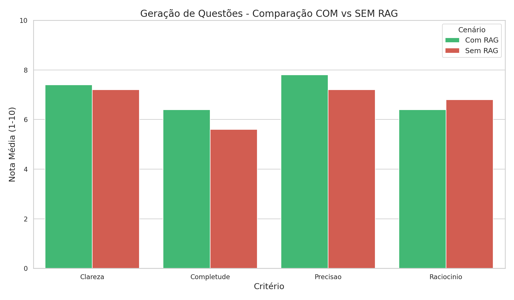
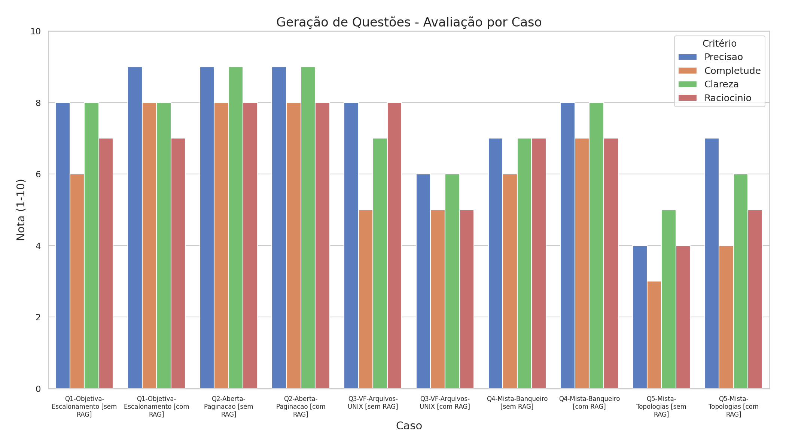

**Geração de Flashcards**
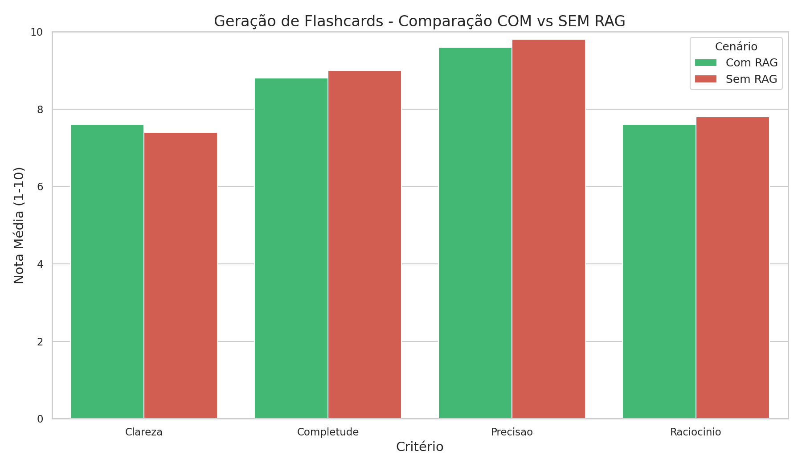
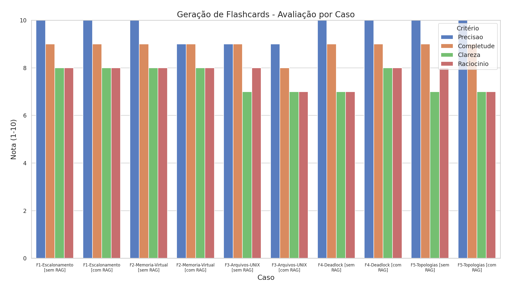

**Recomendação de Estratégia de Estudo**
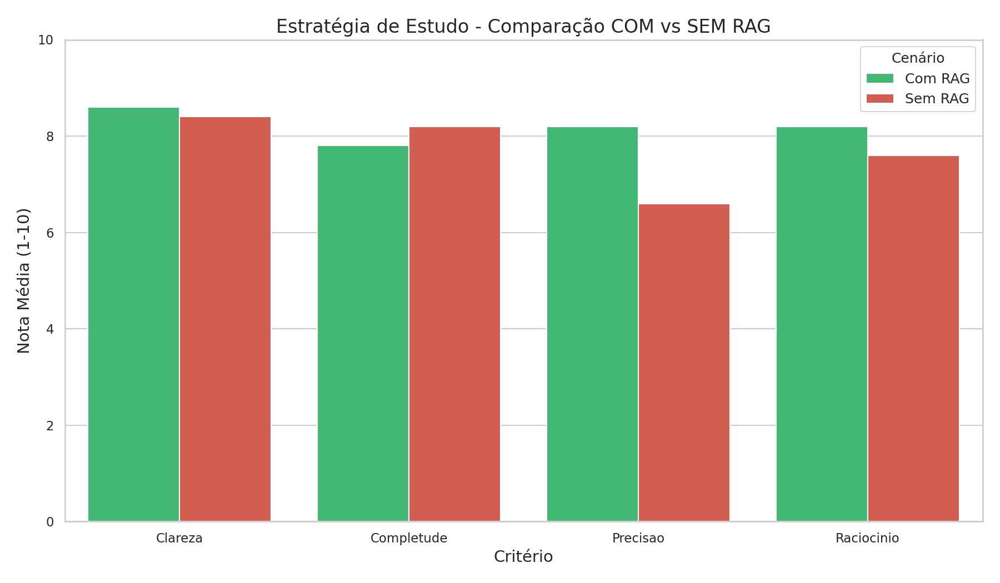
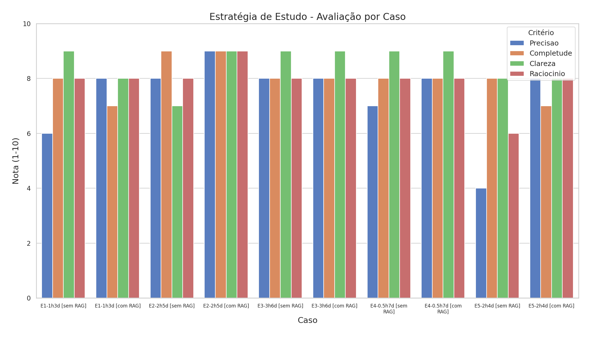

**Pesquisa de Artigos Científicos** (queries alinhadas com Sistemas Operacionais)
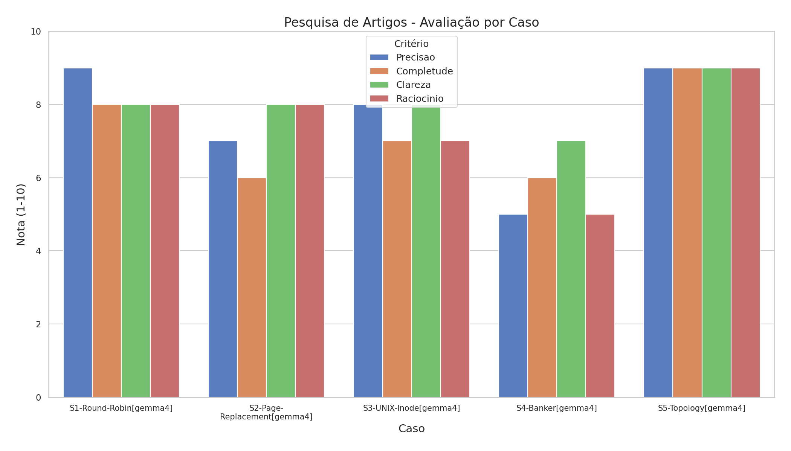

Gráfico consolidado (médias por funcionalidade):
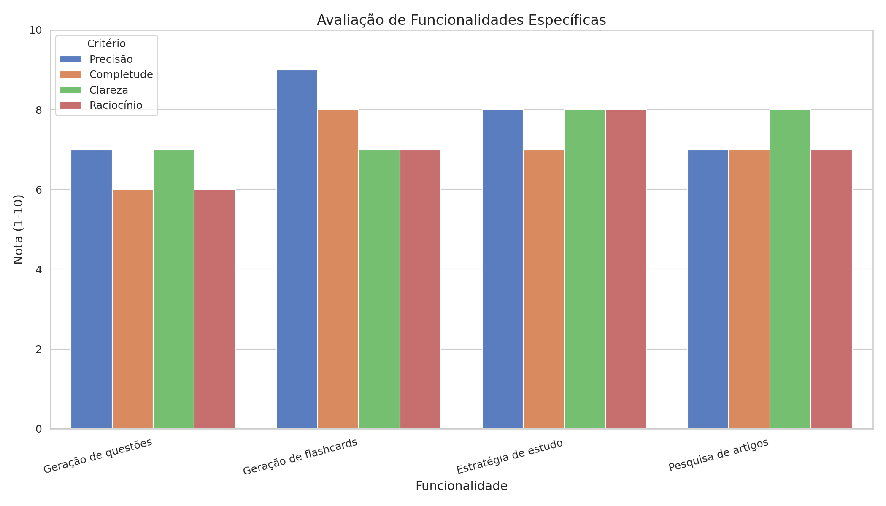

Médias por funcionalidade:

**Geração de questões:**
- SEM RAG: Precisao 7.2, Completude 5.6, Clareza 7.2, Raciocinio 6.8
- COM RAG: Precisao 7.8, Completude 6.4, Clareza 7.4, Raciocinio 6.4

**Geração de flashcards:**
- SEM RAG: Precisao 9.8, Completude 9.0, Clareza 7.4, Raciocinio 7.8
- COM RAG: Precisao 9.6, Completude 8.8, Clareza 7.6, Raciocinio 7.6

> **Atenção — Flashcards:** a IA gerou menos flashcards que o solicitado em 0/5 casos (SEM RAG) e 0/5 casos (COM RAG). Nesses casos, os cards restantes foram preenchidos com conteúdo genérico pelo fallback. Considere dividir em mais lotes em `llm_api/rag.py`.

**Estratégia de estudo:**
- SEM RAG: Precisao 6.6, Completude 8.2, Clareza 8.4, Raciocinio 7.6
- COM RAG: Precisao 8.2, Completude 7.8, Clareza 8.6, Raciocinio 8.2

**Pesquisa de artigos:**
- Precisao 7.6, Completude 7.2, Clareza 8.0, Raciocinio 7.4

9. Impacto do RAG nas Respostas da LLM (Com vs Sem Contexto)
------------------------------------------------------------
Metodologia:
- Cada caso tem uma fase SEM RAG rodada em tópico isolado (apenas imagem indexada).
- Os casos vêm do banco `tests/questoes_so.json` (questões de SO com gabarito e
  fonte verificada); a resposta correta usada pelo juiz é o gabarito oficial, não uma
  interpretação gerada na hora.
- O PDF de referência é extraído nativamente (PyMuPDF) com detecção de colunas e os chunks
  são cacheados em `tests/rag_cache_v9-gptoss-judge-gemma-functional_<md5>.json`.
- Páginas identificadas como TOC ou capa, e chunks com baixo sinal semântico, são
  descartados antes da indexação.
- Os chunks são copiados via /index_documents para cada tópico COM RAG por caso.
- Filtro de similaridade: threshold=0.72, n_results=12
- Filtro de self-match: chunks cuja `source` é igual ao nome da imagem atual são
  descartados (`exclude_source`).

| Caso | Referência | Cenário | Precisão | Completude | Clareza | Raciocínio |
|------|------------|---------|----------|------------|---------|------------|
| so_a01 | Sistemas Operacionais Modernos (Andrew S. Tanenbaum, Herbert Bos).pdf | Sem RAG | 10 | 9 | 9 | 9 |
| so_a01 | Sistemas Operacionais Modernos (Andrew S. Tanenbaum, Herbert Bos).pdf | Com RAG | 10 | 8 | 9 | 9 |
| so_a02 | Sistemas Operacionais Modernos (Andrew S. Tanenbaum, Herbert Bos).pdf | Sem RAG | 10 | 9 | 9 | 9 |
| so_a02 | Sistemas Operacionais Modernos (Andrew S. Tanenbaum, Herbert Bos).pdf | Com RAG | 10 | 9 | 9 | 9 |
| so_a03 | Sistemas Operacionais Modernos (Andrew S. Tanenbaum, Herbert Bos).pdf | Sem RAG | 9 | 9 | 9 | 9 |
| so_a03 | Sistemas Operacionais Modernos (Andrew S. Tanenbaum, Herbert Bos).pdf | Com RAG | 9 | 9 | 9 | 9 |
| so_a04 | Sistemas Operacionais Modernos (Andrew S. Tanenbaum, Herbert Bos).pdf | Sem RAG | 2 | 6 | 7 | 5 |
| so_a04 | Sistemas Operacionais Modernos (Andrew S. Tanenbaum, Herbert Bos).pdf | Com RAG | 2 | 6 | 7 | 5 |
| so_a05 | Sistemas Operacionais Modernos (Andrew S. Tanenbaum, Herbert Bos).pdf | Sem RAG | 9 | 8 | 9 | 9 |
| so_a05 | Sistemas Operacionais Modernos (Andrew S. Tanenbaum, Herbert Bos).pdf | Com RAG | 9 | 8 | 9 | 9 |
| so_a06 | Sistemas Operacionais Modernos (Andrew S. Tanenbaum, Herbert Bos).pdf | Sem RAG | 10 | 8 | 9 | 9 |
| so_a06 | Sistemas Operacionais Modernos (Andrew S. Tanenbaum, Herbert Bos).pdf | Com RAG | 10 | 8 | 9 | 9 |
| so_a07 | Sistemas Operacionais Modernos (Andrew S. Tanenbaum, Herbert Bos).pdf | Sem RAG | 10 | 9 | 9 | 9 |
| so_a07 | Sistemas Operacionais Modernos (Andrew S. Tanenbaum, Herbert Bos).pdf | Com RAG | 10 | 9 | 9 | 9 |
| so_a08 | Sistemas Operacionais Modernos (Andrew S. Tanenbaum, Herbert Bos).pdf | Sem RAG | 9 | 9 | 9 | 9 |
| so_a08 | Sistemas Operacionais Modernos (Andrew S. Tanenbaum, Herbert Bos).pdf | Com RAG | 9 | 8 | 9 | 9 |
| so_a09 | Sistemas Operacionais Modernos (Andrew S. Tanenbaum, Herbert Bos).pdf | Sem RAG | 10 | 9 | 9 | 9 |
| so_a09 | Sistemas Operacionais Modernos (Andrew S. Tanenbaum, Herbert Bos).pdf | Com RAG | 10 | 9 | 9 | 9 |
| so_a10 | Sistemas Operacionais Modernos (Andrew S. Tanenbaum, Herbert Bos).pdf | Sem RAG | 9 | 8 | 9 | 9 |
| so_a10 | Sistemas Operacionais Modernos (Andrew S. Tanenbaum, Herbert Bos).pdf | Com RAG | 9 | 8 | 9 | 9 |
| so_a11 | Sistemas Operacionais Modernos (Andrew S. Tanenbaum, Herbert Bos).pdf | Sem RAG | 9 | 8 | 9 | 9 |
| so_a11 | Sistemas Operacionais Modernos (Andrew S. Tanenbaum, Herbert Bos).pdf | Com RAG | 9 | 8 | 9 | 9 |
| so_a12 | Sistemas Operacionais Modernos (Andrew S. Tanenbaum, Herbert Bos).pdf | Sem RAG | 7 | 5 | 8 | 7 |
| so_a12 | Sistemas Operacionais Modernos (Andrew S. Tanenbaum, Herbert Bos).pdf | Com RAG | 7 | 5 | 8 | 7 |
| so_a13 | Sistemas Operacionais Modernos (Andrew S. Tanenbaum, Herbert Bos).pdf | Sem RAG | 9 | 6 | 9 | 8 |
| so_a13 | Sistemas Operacionais Modernos (Andrew S. Tanenbaum, Herbert Bos).pdf | Com RAG | 9 | 7 | 9 | 8 |
| so_b01 | Sistemas Operacionais Modernos (Andrew S. Tanenbaum, Herbert Bos).pdf | Sem RAG | 10 | 8 | 9 | 9 |
| so_b01 | Sistemas Operacionais Modernos (Andrew S. Tanenbaum, Herbert Bos).pdf | Com RAG | 10 | 9 | 9 | 9 |
| so_b02 | Sistemas Operacionais Modernos (Andrew S. Tanenbaum, Herbert Bos).pdf | Sem RAG | 9 | 9 | 9 | 9 |
| so_b02 | Sistemas Operacionais Modernos (Andrew S. Tanenbaum, Herbert Bos).pdf | Com RAG | 9 | 9 | 9 | 9 |
| so_b03 | Sistemas Operacionais Modernos (Andrew S. Tanenbaum, Herbert Bos).pdf | Sem RAG | 9 | 8 | 8 | 8 |
| so_b03 | Sistemas Operacionais Modernos (Andrew S. Tanenbaum, Herbert Bos).pdf | Com RAG | 9 | 8 | 8 | 8 |
| so_b04 | Sistemas Operacionais Modernos (Andrew S. Tanenbaum, Herbert Bos).pdf | Sem RAG | 10 | 10 | 10 | 10 |
| so_b04 | Sistemas Operacionais Modernos (Andrew S. Tanenbaum, Herbert Bos).pdf | Com RAG | 10 | 10 | 10 | 10 |
| so_b05 | Sistemas Operacionais Modernos (Andrew S. Tanenbaum, Herbert Bos).pdf | Sem RAG | 9 | 8 | 9 | 9 |
| so_b05 | Sistemas Operacionais Modernos (Andrew S. Tanenbaum, Herbert Bos).pdf | Com RAG | 9 | 9 | 9 | 9 |
| so_b06 | Sistemas Operacionais Modernos (Andrew S. Tanenbaum, Herbert Bos).pdf | Sem RAG | 9 | 8 | 9 | 8 |
| so_b06 | Sistemas Operacionais Modernos (Andrew S. Tanenbaum, Herbert Bos).pdf | Com RAG | 9 | 9 | 9 | 9 |
| so_b07 | Sistemas Operacionais Modernos (Andrew S. Tanenbaum, Herbert Bos).pdf | Sem RAG | 9 | 8 | 9 | 9 |
| so_b07 | Sistemas Operacionais Modernos (Andrew S. Tanenbaum, Herbert Bos).pdf | Com RAG | 9 | 8 | 9 | 9 |
| so_b08 | Sistemas Operacionais Modernos (Andrew S. Tanenbaum, Herbert Bos).pdf | Sem RAG | 10 | 9 | 9 | 9 |
| so_b08 | Sistemas Operacionais Modernos (Andrew S. Tanenbaum, Herbert Bos).pdf | Com RAG | 10 | 8 | 9 | 9 |
| so_b09 | Sistemas Operacionais Modernos (Andrew S. Tanenbaum, Herbert Bos).pdf | Sem RAG | 10 | 10 | 9 | 9 |
| so_b09 | Sistemas Operacionais Modernos (Andrew S. Tanenbaum, Herbert Bos).pdf | Com RAG | 10 | 9 | 9 | 9 |
| so_b10 | Sistemas Operacionais Modernos (Andrew S. Tanenbaum, Herbert Bos).pdf | Sem RAG | 9 | 8 | 9 | 9 |
| so_b10 | Sistemas Operacionais Modernos (Andrew S. Tanenbaum, Herbert Bos).pdf | Com RAG | 9 | 9 | 9 | 9 |
| so_b11 | Sistemas Operacionais Modernos (Andrew S. Tanenbaum, Herbert Bos).pdf | Sem RAG | 9 | 8 | 9 | 9 |
| so_b11 | Sistemas Operacionais Modernos (Andrew S. Tanenbaum, Herbert Bos).pdf | Com RAG | 9 | 8 | 9 | 9 |
| so_b12 | Sistemas Operacionais Modernos (Andrew S. Tanenbaum, Herbert Bos).pdf | Sem RAG | 7 | 6 | 7 | 7 |
| so_b12 | Sistemas Operacionais Modernos (Andrew S. Tanenbaum, Herbert Bos).pdf | Com RAG | 7 | 6 | 7 | 7 |
| so_b13 | Sistemas Operacionais Modernos (Andrew S. Tanenbaum, Herbert Bos).pdf | Sem RAG | 7 | 6 | 8 | 7 |
| so_b13 | Sistemas Operacionais Modernos (Andrew S. Tanenbaum, Herbert Bos).pdf | Com RAG | 7 | 6 | 8 | 7 |
| so_c01 | Sistemas Operacionais Modernos (Andrew S. Tanenbaum, Herbert Bos).pdf | Sem RAG | 2 | 5 | 7 | 5 |
| so_c01 | Sistemas Operacionais Modernos (Andrew S. Tanenbaum, Herbert Bos).pdf | Com RAG | 2 | 5 | 7 | 5 |
| so_c02 | Sistemas Operacionais Modernos (Andrew S. Tanenbaum, Herbert Bos).pdf | Sem RAG | 10 | 8 | 9 | 9 |
| so_c02 | Sistemas Operacionais Modernos (Andrew S. Tanenbaum, Herbert Bos).pdf | Com RAG | 10 | 9 | 9 | 9 |
| so_c03 | Sistemas Operacionais Modernos (Andrew S. Tanenbaum, Herbert Bos).pdf | Sem RAG | 10 | 9 | 9 | 9 |
| so_c03 | Sistemas Operacionais Modernos (Andrew S. Tanenbaum, Herbert Bos).pdf | Com RAG | 10 | 9 | 9 | 9 |
| so_c04 | Sistemas Operacionais Modernos (Andrew S. Tanenbaum, Herbert Bos).pdf | Sem RAG | 10 | 9 | 8 | 9 |
| so_c04 | Sistemas Operacionais Modernos (Andrew S. Tanenbaum, Herbert Bos).pdf | Com RAG | 10 | 9 | 8 | 9 |
| so_c05 | Sistemas Operacionais Modernos (Andrew S. Tanenbaum, Herbert Bos).pdf | Sem RAG | 9 | 7 | 8 | 8 |
| so_c05 | Sistemas Operacionais Modernos (Andrew S. Tanenbaum, Herbert Bos).pdf | Com RAG | 9 | 7 | 8 | 8 |
| so_c06 | Sistemas Operacionais Modernos (Andrew S. Tanenbaum, Herbert Bos).pdf | Sem RAG | 5 | 8 | 8 | 6 |
| so_c06 | Sistemas Operacionais Modernos (Andrew S. Tanenbaum, Herbert Bos).pdf | Com RAG | 5 | 8 | 8 | 6 |
| so_c07 | Sistemas Operacionais Modernos (Andrew S. Tanenbaum, Herbert Bos).pdf | Sem RAG | 10 | 9 | 9 | 9 |
| so_c07 | Sistemas Operacionais Modernos (Andrew S. Tanenbaum, Herbert Bos).pdf | Com RAG | 10 | 8 | 9 | 9 |
| so_c08 | Sistemas Operacionais Modernos (Andrew S. Tanenbaum, Herbert Bos).pdf | Sem RAG | 9 | 9 | 9 | 9 |
| so_c08 | Sistemas Operacionais Modernos (Andrew S. Tanenbaum, Herbert Bos).pdf | Com RAG | 9 | 9 | 9 | 9 |
| so_c09 | Sistemas Operacionais Modernos (Andrew S. Tanenbaum, Herbert Bos).pdf | Sem RAG | 9 | 9 | 9 | 9 |
| so_c09 | Sistemas Operacionais Modernos (Andrew S. Tanenbaum, Herbert Bos).pdf | Com RAG | 9 | 8 | 9 | 9 |
| so_c10 | Sistemas Operacionais Modernos (Andrew S. Tanenbaum, Herbert Bos).pdf | Sem RAG | 10 | 8 | 9 | 8 |
| so_c10 | Sistemas Operacionais Modernos (Andrew S. Tanenbaum, Herbert Bos).pdf | Com RAG | 10 | 9 | 9 | 9 |
| so_c11 | Sistemas Operacionais Modernos (Andrew S. Tanenbaum, Herbert Bos).pdf | Sem RAG | 2 | 4 | 7 | 5 |
| so_c11 | Sistemas Operacionais Modernos (Andrew S. Tanenbaum, Herbert Bos).pdf | Com RAG | 9 | 9 | 8 | 9 |
| so_c12 | Sistemas Operacionais Modernos (Andrew S. Tanenbaum, Herbert Bos).pdf | Sem RAG | 9 | 8 | 9 | 9 |
| so_c12 | Sistemas Operacionais Modernos (Andrew S. Tanenbaum, Herbert Bos).pdf | Com RAG | 9 | 8 | 9 | 9 |
| so_d01 | Sistemas Operacionais Modernos (Andrew S. Tanenbaum, Herbert Bos).pdf | Sem RAG | 9 | 8 | 9 | 9 |
| so_d01 | Sistemas Operacionais Modernos (Andrew S. Tanenbaum, Herbert Bos).pdf | Com RAG | 9 | 8 | 9 | 9 |
| so_d02 | Sistemas Operacionais Modernos (Andrew S. Tanenbaum, Herbert Bos).pdf | Sem RAG | 9 | 8 | 9 | 9 |
| so_d02 | Sistemas Operacionais Modernos (Andrew S. Tanenbaum, Herbert Bos).pdf | Com RAG | 9 | 8 | 9 | 9 |
| so_d03 | Sistemas Operacionais Modernos (Andrew S. Tanenbaum, Herbert Bos).pdf | Sem RAG | 9 | 9 | 9 | 9 |
| so_d03 | Sistemas Operacionais Modernos (Andrew S. Tanenbaum, Herbert Bos).pdf | Com RAG | 9 | 9 | 9 | 9 |
| so_d04 | Sistemas Operacionais Modernos (Andrew S. Tanenbaum, Herbert Bos).pdf | Sem RAG | 10 | 8 | 9 | 8 |
| so_d04 | Sistemas Operacionais Modernos (Andrew S. Tanenbaum, Herbert Bos).pdf | Com RAG | 10 | 8 | 9 | 8 |
| so_d05 | Sistemas Operacionais Modernos (Andrew S. Tanenbaum, Herbert Bos).pdf | Sem RAG | 9 | 8 | 9 | 9 |
| so_d05 | Sistemas Operacionais Modernos (Andrew S. Tanenbaum, Herbert Bos).pdf | Com RAG | 9 | 8 | 9 | 9 |
| so_d06 | Sistemas Operacionais Modernos (Andrew S. Tanenbaum, Herbert Bos).pdf | Sem RAG | 9 | 8 | 9 | 8 |
| so_d06 | Sistemas Operacionais Modernos (Andrew S. Tanenbaum, Herbert Bos).pdf | Com RAG | 9 | 7 | 8 | 8 |
| so_d07 | Sistemas Operacionais Modernos (Andrew S. Tanenbaum, Herbert Bos).pdf | Sem RAG | 9 | 7 | 9 | 9 |
| so_d07 | Sistemas Operacionais Modernos (Andrew S. Tanenbaum, Herbert Bos).pdf | Com RAG | 9 | 7 | 9 | 9 |
| so_d08 | Sistemas Operacionais Modernos (Andrew S. Tanenbaum, Herbert Bos).pdf | Sem RAG | 9 | 9 | 9 | 9 |
| so_d08 | Sistemas Operacionais Modernos (Andrew S. Tanenbaum, Herbert Bos).pdf | Com RAG | 9 | 9 | 9 | 9 |
| so_d09 | Sistemas Operacionais Modernos (Andrew S. Tanenbaum, Herbert Bos).pdf | Sem RAG | 9 | 9 | 9 | 9 |
| so_d09 | Sistemas Operacionais Modernos (Andrew S. Tanenbaum, Herbert Bos).pdf | Com RAG | 9 | 9 | 9 | 9 |
| so_d10 | Sistemas Operacionais Modernos (Andrew S. Tanenbaum, Herbert Bos).pdf | Sem RAG | 10 | 9 | 9 | 9 |
| so_d10 | Sistemas Operacionais Modernos (Andrew S. Tanenbaum, Herbert Bos).pdf | Com RAG | 10 | 9 | 9 | 9 |
| so_d11 | Sistemas Operacionais Modernos (Andrew S. Tanenbaum, Herbert Bos).pdf | Sem RAG | 9 | 7 | 9 | 9 |
| so_d11 | Sistemas Operacionais Modernos (Andrew S. Tanenbaum, Herbert Bos).pdf | Com RAG | 9 | 7 | 9 | 9 |
| so_d12 | Sistemas Operacionais Modernos (Andrew S. Tanenbaum, Herbert Bos).pdf | Sem RAG | 9 | 7 | 9 | 9 |
| so_d12 | Sistemas Operacionais Modernos (Andrew S. Tanenbaum, Herbert Bos).pdf | Com RAG | 9 | 8 | 9 | 9 |

**Diagnóstico de contexto e similaridade:**

| Caso | Ctx SEM (chars) | Ctx COM (chars) | Delta | Similaridade | Sentenças mudadas | Respostas iguais? |
|------|----------------|------------------|-------|--------------|-------------------|-------------------|
| so_a01 | 0 | 5011 | 5011 | 37.1% | 18 | Não |
| so_a02 | 0 | 4864 | 4864 | 43.4% | 12 | Não |
| so_a03 | 0 | 5172 | 5172 | 38.9% | 18 | Não |
| so_a04 | 0 | 5463 | 5463 | 25.4% | 18 | Não |
| so_a05 | 0 | 5389 | 5389 | 66.5% | 10 | Não |
| so_a06 | 0 | 5547 | 5547 | 33.7% | 22 | Não |
| so_a07 | 0 | 5260 | 5260 | 60.1% | 18 | Não |
| so_a08 | 0 | 6126 | 6126 | 47.0% | 19 | Não |
| so_a09 | 0 | 4652 | 4652 | 33.5% | 12 | Não |
| so_a10 | 0 | 5810 | 5810 | 25.9% | 21 | Não |
| so_a11 | 0 | 5389 | 5389 | 24.4% | 11 | Não |
| so_a12 | 0 | 4939 | 4939 | 41.3% | 19 | Não |
| so_a13 | 0 | 5297 | 5297 | 72.6% | 11 | Não |
| so_b01 | 0 | 5478 | 5478 | 43.1% | 11 | Não |
| so_b02 | 0 | 5103 | 5103 | 31.6% | 12 | Não |
| so_b03 | 0 | 4643 | 4643 | 22.9% | 30 | Não |
| so_b04 | 0 | 3794 | 3794 | 13.9% | 19 | Não |
| so_b05 | 0 | 5316 | 5316 | 24.8% | 15 | Não |
| so_b06 | 0 | 4286 | 4286 | 8.3% | 2 | Não |
| so_b07 | 0 | 4229 | 4229 | 57.7% | 20 | Não |
| so_b08 | 0 | 4562 | 4562 | 72.5% | 13 | Não |
| so_b09 | 0 | 5076 | 5076 | 68.5% | 7 | Não |
| so_b10 | 0 | 4446 | 4446 | 33.9% | 20 | Não |
| so_b11 | 0 | 4690 | 4690 | 31.2% | 30 | Não |
| so_b12 | 0 | 5545 | 5545 | 15.4% | 38 | Não |
| so_b13 | 0 | 4947 | 4947 | 7.2% | 38 | Não |
| so_c01 | 0 | 4807 | 4807 | 31.1% | 20 | Não |
| so_c02 | 0 | 5173 | 5173 | 53.6% | 17 | Não |
| so_c03 | 0 | 5017 | 5017 | 39.9% | 24 | Não |
| so_c04 | 0 | 5716 | 5716 | 26.8% | 39 | Não |
| so_c05 | 0 | 5227 | 5227 | 56.6% | 27 | Não |
| so_c06 | 0 | 4977 | 4977 | 38.1% | 47 | Não |
| so_c07 | 0 | 4801 | 4801 | 48.4% | 12 | Não |
| so_c08 | 0 | 5173 | 5173 | 55.6% | 14 | Não |
| so_c09 | 0 | 4559 | 4559 | 51.4% | 14 | Não |
| so_c10 | 0 | 5128 | 5128 | 41.3% | 19 | Não |
| so_c11 | 0 | 3459 | 3459 | 26.8% | 23 | Não |
| so_c12 | 0 | 5228 | 5228 | 29.0% | 13 | Não |
| so_d01 | 0 | 5600 | 5600 | 15.8% | 17 | Não |
| so_d02 | 0 | 5065 | 5065 | 24.4% | 14 | Não |
| so_d03 | 0 | 5933 | 5933 | 18.9% | 12 | Não |
| so_d04 | 0 | 6075 | 6075 | 32.1% | 18 | Não |
| so_d05 | 0 | 5378 | 5378 | 53.6% | 16 | Não |
| so_d06 | 0 | 5088 | 5088 | 42.9% | 10 | Não |
| so_d07 | 0 | 4949 | 4949 | 41.8% | 18 | Não |
| so_d08 | 0 | 5995 | 5995 | 59.3% | 19 | Não |
| so_d09 | 0 | 6349 | 6349 | 57.7% | 16 | Não |
| so_d10 | 0 | 5752 | 5752 | 52.2% | 15 | Não |
| so_d11 | 0 | 5269 | 5269 | 56.9% | 25 | Não |
| so_d12 | 0 | 5914 | 5914 | 21.7% | 19 | Não |

**Diagnóstico do ranking de chunks (filtro de similaridade + self-match + unusable):**

| Caso | Threshold | Chunks COM (raw) | Chunks COM (passou) | Chunks COM (self-match) | Chunks COM (inúteis) | Chunks SEM (raw) | Chunks SEM (passou) | Chunks SEM (self-match) | Chunks SEM (inúteis) |
|------|-----------|------------------|---------------------|-------------------------|----------------------|------------------|---------------------|-------------------------|----------------------|
| so_a01 | 0.72 | 12 | 11 | 1 | 0 | 1 | 0 | 1 | 0 |
| so_a02 | 0.72 | 12 | 11 | 1 | 0 | 1 | 0 | 1 | 0 |
| so_a03 | 0.72 | 12 | 11 | 1 | 0 | 1 | 0 | 1 | 0 |
| so_a04 | 0.72 | 12 | 11 | 1 | 0 | 2 | 0 | 2 | 0 |
| so_a05 | 0.72 | 12 | 11 | 1 | 0 | 1 | 0 | 1 | 0 |
| so_a06 | 0.72 | 12 | 12 | 0 | 0 | 3 | 0 | 3 | 0 |
| so_a07 | 0.72 | 12 | 12 | 0 | 0 | 1 | 0 | 1 | 0 |
| so_a08 | 0.72 | 12 | 12 | 0 | 0 | 2 | 0 | 2 | 0 |
| so_a09 | 0.72 | 12 | 11 | 1 | 0 | 1 | 0 | 1 | 0 |
| so_a10 | 0.72 | 12 | 12 | 0 | 0 | 0 | 0 | 0 | 0 |
| so_a11 | 0.72 | 12 | 11 | 1 | 0 | 1 | 0 | 1 | 0 |
| so_a12 | 0.72 | 12 | 11 | 1 | 0 | 1 | 0 | 1 | 0 |
| so_a13 | 0.72 | 12 | 12 | 0 | 0 | 1 | 0 | 1 | 0 |
| so_b01 | 0.72 | 12 | 12 | 0 | 0 | 1 | 0 | 1 | 0 |
| so_b02 | 0.72 | 12 | 11 | 1 | 0 | 1 | 0 | 1 | 0 |
| so_b03 | 0.72 | 12 | 10 | 2 | 0 | 3 | 0 | 3 | 0 |
| so_b04 | 0.72 | 12 | 8 | 4 | 0 | 4 | 0 | 4 | 0 |
| so_b05 | 0.72 | 12 | 10 | 2 | 0 | 2 | 0 | 2 | 0 |
| so_b06 | 0.72 | 12 | 10 | 2 | 0 | 3 | 0 | 3 | 0 |
| so_b07 | 0.72 | 12 | 9 | 3 | 0 | 3 | 0 | 3 | 0 |
| so_b08 | 0.72 | 12 | 11 | 1 | 0 | 1 | 0 | 1 | 0 |
| so_b09 | 0.72 | 12 | 11 | 1 | 0 | 2 | 0 | 2 | 0 |
| so_b10 | 0.72 | 12 | 10 | 2 | 0 | 2 | 0 | 2 | 0 |
| so_b11 | 0.72 | 12 | 10 | 2 | 0 | 2 | 0 | 2 | 0 |
| so_b12 | 0.72 | 12 | 12 | 0 | 0 | 3 | 0 | 3 | 0 |
| so_b13 | 0.72 | 12 | 11 | 1 | 0 | 4 | 0 | 4 | 0 |
| so_c01 | 0.72 | 12 | 11 | 1 | 0 | 1 | 0 | 1 | 0 |
| so_c02 | 0.72 | 12 | 11 | 1 | 0 | 1 | 0 | 1 | 0 |
| so_c03 | 0.72 | 12 | 11 | 1 | 0 | 1 | 0 | 1 | 0 |
| so_c04 | 0.72 | 12 | 11 | 1 | 0 | 1 | 0 | 1 | 0 |
| so_c05 | 0.72 | 12 | 12 | 0 | 0 | 1 | 0 | 1 | 0 |
| so_c06 | 0.72 | 12 | 12 | 0 | 0 | 1 | 0 | 1 | 0 |
| so_c07 | 0.72 | 12 | 11 | 1 | 0 | 1 | 0 | 1 | 0 |
| so_c08 | 0.72 | 12 | 10 | 2 | 0 | 3 | 0 | 3 | 0 |
| so_c09 | 0.72 | 12 | 11 | 1 | 0 | 3 | 0 | 3 | 0 |
| so_c10 | 0.72 | 12 | 11 | 1 | 0 | 3 | 0 | 3 | 0 |
| so_c11 | 0.72 | 12 | 7 | 5 | 0 | 5 | 0 | 5 | 0 |
| so_c12 | 0.72 | 12 | 11 | 1 | 0 | 1 | 0 | 1 | 0 |
| so_d01 | 0.72 | 12 | 12 | 0 | 0 | 2 | 0 | 2 | 0 |
| so_d02 | 0.72 | 12 | 11 | 1 | 0 | 1 | 0 | 1 | 0 |
| so_d03 | 0.72 | 12 | 11 | 1 | 0 | 1 | 0 | 1 | 0 |
| so_d04 | 0.72 | 12 | 12 | 0 | 0 | 1 | 0 | 1 | 0 |
| so_d05 | 0.72 | 12 | 10 | 2 | 0 | 7 | 0 | 7 | 0 |
| so_d06 | 0.72 | 12 | 11 | 1 | 0 | 1 | 0 | 1 | 0 |
| so_d07 | 0.72 | 12 | 11 | 1 | 0 | 1 | 0 | 1 | 0 |
| so_d08 | 0.72 | 12 | 11 | 1 | 0 | 1 | 0 | 1 | 0 |
| so_d09 | 0.72 | 12 | 11 | 1 | 0 | 1 | 0 | 1 | 0 |
| so_d10 | 0.72 | 12 | 10 | 2 | 0 | 2 | 0 | 2 | 0 |
| so_d11 | 0.72 | 12 | 11 | 1 | 0 | 2 | 0 | 2 | 0 |
| so_d12 | 0.72 | 12 | 11 | 1 | 0 | 1 | 0 | 1 | 0 |

**Detalhamento por chunk (top-12 por caso COM RAG, primeiros 10 casos):**

**Caso `so_a01`** (threshold=0.72):

| Rank | Status | Sim | Weight | Score | Src | Idx | Preview |
|------|--------|-----|--------|-------|-----|-----|---------|
| 0 | OK | 0.890 | 1.00 | 0.890 | Sistemas_Operacionai | 1322 | ativas curtas. Um quantum em torno de 20-50 ms é muitas vezes bastante razoável. |
| 1 | OK | 0.883 | 1.00 | 0.883 | Sistemas_Operacionai | 1314 | interessante em relação ao escalonamento circular é o comprimento do quan- tum.  |
| 2 | SELF | 0.882 | 0.00 | 0.000 | synthetic_so_a01.png | 0 | Considerando-se o algoritmo de escalonamento por alternância circular (round-rob |
| 3 | OK | 0.875 | 1.00 | 0.875 | Sistemas_Operacionai | 6082 | um quanta de tempo associado a eles e são passíveis de preempção pelo reló- gio. |
| 4 | OK | 0.874 | 1.00 | 0.874 | Sistemas_Operacionai | 1465 | o de contexto afetam um ao outro, em um algoritmo de escalonamento circular. 43. |
| 5 | OK | 0.872 | 1.00 | 0.872 | Sistemas_Operacionai | 1312 | os mais antigos, simples, justos e amplamente usados é o circular (round-robin). |
| 6 | OK | 0.871 | 1.00 | 0.871 | Sistemas_Operacionai | 4417 | B1 A1 CPU 1 Tempo 0 100 200 300 400 500 600 FIGURA 8.15  Escalonamento em bando. |
| 7 | OK | 0.868 | 1.00 | 0.868 | Sistemas_Operacionai | 1313 | o processo bloquear, é claro. O escalona- mento circular é fácil de implementar. |
| 8 | OK | 0.868 | 1.00 | 0.868 | Sistemas_Operacionai | 950 | nar processos pelo es- quema de escalonamento circular (dando a vez ao ou- tro). |
| 9 | OK | 0.866 | 1.00 | 0.866 | Sistemas_Operacionai | 1311 | ciada. Esse es- quema permite que tarefas curtas novas tenham um bom desempenho. |
| 10 | OK | 0.865 | 1.00 | 0.865 | Sistemas_Operacionai | 4416 | . Isso significa que o tempo é dividido em quanta discretos como na Figura 8.14. |
| 11 | OK | 0.865 | 1.00 | 0.865 | Sistemas_Operacionai | 4419 | ntervalo de tempo 4 sendo o mesmo que o intervalo de tempo 0 e assim por diante. |

**Caso `so_a02`** (threshold=0.72):

| Rank | Status | Sim | Weight | Score | Src | Idx | Preview |
|------|--------|-----|--------|-------|-----|-----|---------|
| 0 | SELF | 0.857 | 0.00 | 0.000 | synthetic_so_a02.png | 0 | Considerando que os processos P1, P2, P3, P4 e P5 tenham tempo de burst de CPU,  |
| 1 | OK | 0.843 | 1.00 | 0.843 | Sistemas_Operacionai | 3048 | o tempo de busca mé- dio pode melhorar substancialmente o desempenho do sistema. |
| 2 | OK | 0.838 | 1.00 | 0.838 | Sistemas_Operacionai | 3050 | indro encadeadas juntas em uma lista ligada encabeçada pelas entradas da tabela. |
| 3 | OK | 0.838 | 1.00 | 0.838 | Sistemas_Operacionai | 3054 | , os movimentos de braço são 1, 3, 7, 15, 33 e 2, para um total de 61 cilindros. |
| 4 | OK | 0.829 | 1.00 | 0.829 | Sistemas_Operacionai | 3051 | oritmo de escalonamento “busca mais curta primeiro” (SSF — Shortest Seek First). |
| 5 | OK | 0.829 | 1.00 | 0.829 | Sistemas_Operacionai | 3056 | uma solicitação pelo cilindro 13, o braço irá em seguida para o 13, em vez do 1. |
| 6 | OK | 0.828 | 1.00 | 0.828 | Sistemas_Operacionai | 1726 | baixo custo é o primeiro a entrar, primeiro a sair (first in, first out — FIFO). |
| 7 | OK | 0.827 | 1.00 | 0.827 | Sistemas_Operacionai | 4413 | r. Suponha que por acaso A0 e B1 comecem primeiro, como mostrado na Figura 8.14. |
| 8 | OK | 0.824 | 1.00 | 0.824 | Sistemas_Operacionai | 3062 | do elevador é ligeiramente melhor do que o SSF, em- bora ele seja em geral pior. |
| 9 | OK | 0.822 | 1.00 | 0.822 | Sistemas_Operacionai | 3061 | guma. Se ne- nhuma solicitação estiver pendente, ele simplesmente para e espera. |
| 10 | OK | 0.821 | 1.00 | 0.821 | Sistemas_Operacionai | 1303 | preemptivo que presume que os tempos de execução são conhecidos antecipadamente. |
| 11 | OK | 0.821 | 1.00 | 0.821 | Sistemas_Operacionai | 1419 | uando ele chegou, mas não precisa esperar por leitores que chegaram depois dele. |

**Caso `so_a03`** (threshold=0.72):

| Rank | Status | Sim | Weight | Score | Src | Idx | Preview |
|------|--------|-----|--------|-------|-----|-----|---------|
| 0 | OK | 0.857 | 1.00 | 0.857 | Sistemas_Operacionai | 6900 | ? 13. Um processo Linux não em tempo real tem níveis de prioridade de 100 a 139. |
| 1 | SELF | 0.845 | 0.00 | 0.000 | synthetic_so_a03.png | 0 | Sobre gerenciamento de processos no sistema operacional Linux, analise as afirma |
| 2 | OK | 0.839 | 1.00 | 0.839 | Sistemas_Operacionai | 1328 | em custar US$ 100 uma hora, prioridade média US$ 75 e baixa priorida- de US$ 50. |
| 3 | OK | 0.837 | 1.00 | 0.837 | Sistemas_Operacionai | 6012 | status configurado para 0x0400 (0x como um prefixo significa hexadecimal em C).  |
| 4 | OK | 0.834 | 1.00 | 0.834 | Sistemas_Operacionai | 6605 | vik installd servicemanager adbd init Núcleo como escalonamento de tarefas cron. |
| 5 | OK | 0.834 | 1.00 | 0.834 | Sistemas_Operacionai | 6851 | fluxo para começar uma atividade em um novo processo é mostrado na Figura 10.67. |
| 6 | OK | 0.831 | 1.00 | 0.831 | Sistemas_Operacionai | 6088 | a resolução permitem que o núcleo controle o tempo em granularidade subinstante. |
| 7 | OK | 0.831 | 1.00 | 0.831 | Sistemas_Operacionai | 6643 | curso e tem difi- culdade em identificar corretamente bons processos para matar. |
| 8 | OK | 0.829 | 1.00 | 0.829 | Sistemas_Operacionai | 6660 | -carregados e inicializados com zygote através das páginas com cópia na escrita. |
| 9 | OK | 0.829 | 1.00 | 0.829 | Sistemas_Operacionai | 6606 | iro é o processo init, que gera uma série de processos de daemon de baixo nível. |
| 10 | OK | 0.828 | 1.00 | 0.828 | Sistemas_Operacionai | 1061 | */ / ;] N [ d e ts e r e t nit ni * todos os valores 0 (FALSE) */ void enter reg |
| 11 | OK | 0.827 | 1.00 | 0.827 | Sistemas_Operacionai | 6657 | ­ ware móvel, mesmo sem precisar inicializar um novo ambiente de linguagem Java. |

**Caso `so_a04`** (threshold=0.72):

| Rank | Status | Sim | Weight | Score | Src | Idx | Preview |
|------|--------|-----|--------|-------|-----|-----|---------|
| 0 | OK | 0.891 | 1.00 | 0.891 | Sistemas_Operacionai | 4315 | e executá-lo. Quando FIGURA 8.9  O modelo de multiprocessadores simétrico (SMP). |
| 1 | OK | 0.890 | 1.00 | 0.890 | Sistemas_Operacionai | 4314 | e executável para pequenos multipro- cessadores, mas para os grandes ele falha.  |
| 2 | OK | 0.881 | 1.00 | 0.881 | Sistemas_Operacionai | 4209 | , diferentes questões estão pre- sentes e diferentes abordagens são necessárias. |
| 3 | OK | 0.879 | 1.00 | 0.879 | Sistemas_Operacionai | 8465 | serve de ponto de partida para quatro artigos adicionais sobre o mesmo assunto.  |
| 4 | OK | 0.879 | 1.00 | 0.879 | Sistemas_Operacionai | 4202 | ter- conexão C Memória compar- tilhada M C C C C C C C C C C M M (a) (b) (c) ns. |
| 5 | OK | 0.877 | 1.00 | 0.877 | Sistemas_Operacionai | 4212 | b) Com a utilização de cache. (c) Com a utilização de cache e memórias privadas. |
| 6 | OK | 0.876 | 1.00 | 0.876 | Sistemas_Operacionai | 4595 | oces- sadores, multicomputadores e sistemas distribuídos nos pontos mencionados. |
| 7 | OK | 0.875 | 1.00 | 0.875 | Sistemas_Operacionai | 4211 | e processadores: uma CPU escreve alguns dados na memória e outra lê esses dados. |
| 8 | SELF | 0.874 | 0.00 | 0.000 | synthetic_so_a04.png | 0 | Um sistema operacional multiprocessador com memória compartilhada caracteriza-se |
| 9 | OK | 0.873 | 1.00 | 0.873 | Sistemas_Operacionai | 4308 | hamento que leve a problemas de consistência ou necessidade de ex- clusão mútua. |
| 10 | OK | 0.870 | 1.00 | 0.870 | Sistemas_Operacionai | 8462 | presenta uma visão geral de alguns grandes sistemas em funcionamento atualmente. |
| 11 | OK | 0.869 | 1.00 | 0.869 | Sistemas_Operacionai | 4271 | multiprocessadores. Uma cache L2 ou L3 com- partilhada pode afetar o desempenho. |

**Caso `so_a05`** (threshold=0.72):

| Rank | Status | Sim | Weight | Score | Src | Idx | Preview |
|------|--------|-----|--------|-------|-----|-----|---------|
| 0 | SELF | 0.881 | 0.00 | 0.000 | synthetic_so_a05.png | 0 | No que se refere a sistemas operacionais, Windows Server e serviços de diretório |
| 1 | OK | 0.876 | 1.00 | 0.876 | Sistemas_Operacionai | 1324 | de levar em consideração fatores externos leva ao escalonamento por prioridades. |
| 2 | OK | 0.874 | 1.00 | 0.874 | Sistemas_Operacionai | 1268 | sso mais prioritário esteja espe- rando por um tempo de espera agora satisfeito. |
| 3 | OK | 0.873 | 1.00 | 0.873 | Sistemas_Operacionai | 8153 | X e no Windows 8, o mecanismo é um arranjo, indexado pelo nível de prio- ridade. |
| 4 | OK | 0.868 | 1.00 | 0.868 | Sistemas_Operacionai | 1450 | rado na Figura 2.24 funciona quando o escalo- namento de processos é preemptivo? |
| 5 | OK | 0.867 | 1.00 | 0.867 | Sistemas_Operacionai | 1331 | a prioridade para 1/f, onde f é a fração do último quantum que o processo usou.  |
| 6 | OK | 0.866 | 1.00 | 0.866 | Sistemas_Operacionai | 615 | a política. Para esclarecer esse ponto, considere o escalonamento de processos.  |
| 7 | OK | 0.863 | 1.00 | 0.863 | Sistemas_Operacionai | 1325 | ais baixa do que a um processo exibindo um filme de vídeo na tela em tempo real. |
| 8 | OK | 0.861 | 1.00 | 0.861 | Sistemas_Operacionai | 1332 | ori- dades entre as classes, mas escalonamento circular den- tro de cada classe. |
| 9 | OK | 0.860 | 1.00 | 0.860 | Sistemas_Operacionai | 7510 | - to. A API Win32 fornece duas APIs para influenciar o escalonamento de threads. |
| 10 | OK | 0.860 | 1.00 | 0.860 | Sistemas_Operacionai | 1327 | . Prioridades podem ser designadas a processos estati- camente ou dinamicamente. |
| 11 | OK | 0.859 | 1.00 | 0.859 | Sistemas_Operacionai | 1303 | preemptivo que presume que os tempos de execução são conhecidos antecipadamente. |

**Caso `so_a06`** (threshold=0.72):

| Rank | Status | Sim | Weight | Score | Src | Idx | Preview |
|------|--------|-----|--------|-------|-----|-----|---------|
| 0 | OK | 0.889 | 1.00 | 0.889 | Sistemas_Operacionai | 899 | na primeira coluna são pro- priedades de processos, não threads de propriedades. |
| 1 | OK | 0.880 | 1.00 | 0.880 | Sistemas_Operacionai | 1128 | o entre processos e threads torna-se confusa, mas segue de certa forma presente. |
| 2 | OK | 0.878 | 1.00 | 0.878 | Sistemas_Operacionai | 1129 | s por processo, enquanto os threads dentro de um único processo os compartilham. |
| 3 | OK | 0.876 | 1.00 | 0.876 | Sistemas_Operacionai | 889 | las execuções no mesmo ambiente, com um alto grau de independência uma da outra. |
| 4 | OK | 0.876 | 1.00 | 0.876 | Sistemas_Operacionai | 885 | s e como eles podem ser usados, vamos investigar a ideia um pouco mais de perto. |
| 5 | OK | 0.874 | 1.00 | 0.874 | Sistemas_Operacionai | 897 | o há proteção entre threads, porque (1) é impossível e (2) não seria necessário. |
| 6 | OK | 0.872 | 1.00 | 0.872 | Sistemas_Operacionai | 862 | o não funcionaria aqui, pois todos os três threads precisam operar no documento. |
| 7 | OK | 0.872 | 1.00 | 0.872 | Sistemas_Operacionai | 1127 | cessos compartilharem alguma por- ção do seu espaço de endereçamento com outros. |
| 8 | OK | 0.871 | 1.00 | 0.871 | Sistemas_Operacionai | 6677 | partilhado.) Observe que cada processo na Figura 10.43 tem um “pool de threads”. |
| 9 | OK | 0.871 | 1.00 | 0.871 | Sistemas_Operacionai | 890 | rocessos compartilham memórias físicas, discos, im- pressoras e outros recursos. |
| 10 | OK | 0.870 | 1.00 | 0.870 | Sistemas_Operacionai | 843 | e chaveamentos de contextos, podemos pensar a respeito de processos em paralelo. |
| 11 | OK | 0.869 | 1.00 | 0.869 | Sistemas_Operacionai | 7535 | u- mentado novamente. Há outro caso no qual o sistema mexe com as prio- ridades. |

**Caso `so_a07`** (threshold=0.72):

| Rank | Status | Sim | Weight | Score | Src | Idx | Preview |
|------|--------|-----|--------|-------|-----|-----|---------|
| 0 | OK | 0.883 | 1.00 | 0.883 | Sistemas_Operacionai | 934 | ução. Essa rotina verifica se o thread precisa ser colocado no estado bloqueado. |
| 1 | OK | 0.873 | 1.00 | 0.873 | Sistemas_Operacionai | 931 | isa da sua própria tabela de threads privada para controlá-los naquele processo. |
| 2 | OK | 0.867 | 1.00 | 0.867 | Sistemas_Operacionai | 900 | threads em um processo. A segunda lista alguns itens específicos a cada thread.  |
| 3 | OK | 0.860 | 1.00 | 0.860 | Sistemas_Operacionai | 824 | urado para apontar para uma pilha tem- porária usada pelo tratador de processos. |
| 4 | OK | 0.857 | 1.00 | 0.857 | Sistemas_Operacionai | 1442 | registradores é listado como um item por thread em vez de por processo. Por quê? |
| 5 | OK | 0.856 | 1.00 | 0.856 | Sistemas_Operacionai | 2072 | eção de 0). Dê a sequência de referências de pági- na geradas por esse programa. |
| 6 | OK | 0.856 | 1.00 | 0.856 | Sistemas_Operacionai | 1009 | executarem rotinas de biblioteca- -padrão e outros forem escritos por usuários.  |
| 7 | OK | 0.855 | 1.00 | 0.855 | Sistemas_Operacionai | 823 | EMAS OPERACIONAIS MODERNOS para o endereço especificado no vetor de interrupção. |
| 8 | OK | 0.853 | 1.00 | 0.853 | Sistemas_Operacionai | 998 | global(“bufptr”); Figura 2.20  Threads podem ter variáveis globais individuais. |
| 9 | OK | 0.853 | 1.00 | 0.853 | Sistemas_Operacionai | 5248 | carregar um valor da memória em um regis- trador, ou empilhar um valor na pilha. |
| 10 | OK | 0.852 | 1.00 | 0.852 | Sistemas_Operacionai | 7552 | espaço privado de endereçamento por processo e chamadas de sistema mais rápidas. |
| 11 | OK | 0.852 | 1.00 | 0.852 | Sistemas_Operacionai | 935 | trocados, o novo thread ressurge para a vida novamente de maneira auto- mática.  |

**Caso `so_a08`** (threshold=0.72):

| Rank | Status | Sim | Weight | Score | Src | Idx | Preview |
|------|--------|-----|--------|-------|-----|-----|---------|
| 0 | OK | 0.883 | 1.00 | 0.883 | Sistemas_Operacionai | 843 | e chaveamentos de contextos, podemos pensar a respeito de processos em paralelo. |
| 1 | OK | 0.880 | 1.00 | 0.880 | Sistemas_Operacionai | 1129 | s por processo, enquanto os threads dentro de um único processo os compartilham. |
| 2 | OK | 0.878 | 1.00 | 0.878 | Sistemas_Operacionai | 1127 | cessos compartilharem alguma por- ção do seu espaço de endereçamento com outros. |
| 3 | OK | 0.877 | 1.00 | 0.877 | Sistemas_Operacionai | 740 | apí- tulo, examinaremos detalhadamente os processos e seus “primos”, os threads. |
| 4 | OK | 0.876 | 1.00 | 0.876 | Sistemas_Operacionai | 6064 | thread(s) original(ais) e o novo compartilhavam tudo, exceto seus registradores. |
| 5 | OK | 0.876 | 1.00 | 0.876 | Sistemas_Operacionai | 7432 | desses threads posterior- mente, quando chegarmos ao gerenciamento de me- mória. |
| 6 | OK | 0.875 | 1.00 | 0.875 | Sistemas_Operacionai | 897 | o há proteção entre threads, porque (1) é impossível e (2) não seria necessário. |
| 7 | OK | 0.874 | 1.00 | 0.874 | Sistemas_Operacionai | 890 | rocessos compartilham memórias físicas, discos, im- pressoras e outros recursos. |
| 8 | OK | 0.874 | 1.00 | 0.874 | Sistemas_Operacionai | 883 | ria ser estruturado com um thread de entrada, um de processamento e um de saída. |
| 9 | OK | 0.874 | 1.00 | 0.874 | Sistemas_Operacionai | 6167 | inho de alta largura de banda para múltiplos processos compartilharem me- mória. |
| 10 | OK | 0.874 | 1.00 | 0.874 | Sistemas_Operacionai | 5681 | uma parte do processo (o applet) e o resto, o con- ceito de processo não ajuda.  |
| 11 | OK | 0.874 | 1.00 | 0.874 | Sistemas_Operacionai | 874 | pachante. (b) Thread operário. enquanto o servidor estiver esperando pelo disco. |

**Caso `so_a09`** (threshold=0.72):

| Rank | Status | Sim | Weight | Score | Src | Idx | Preview |
|------|--------|-----|--------|-------|-----|-----|---------|
| 0 | OK | 0.876 | 1.00 | 0.876 | Sistemas_Operacionai | 1349 | ue cada um tem direito, especificamente, o tempo desde a criação dividido por n. |
| 1 | SELF | 0.874 | 0.00 | 0.000 | synthetic_so_a09.png | 0 | Avalie se é verdadeiro (V) ou falso (F): Em um sistema de tempo compartilhado, o |
| 2 | OK | 0.867 | 1.00 | 0.867 | Sistemas_Operacionai | 134 | dício de metade do dia do pro- gramador. Programadores não gostavam muito disso. |
| 3 | OK | 0.867 | 1.00 | 0.867 | Sistemas_Operacionai | 4415 | o bando executam ao mes- mo tempo em diferentes CPUs com tempo compartilhado. 3. |
| 4 | OK | 0.867 | 1.00 | 0.867 | Sistemas_Operacionai | 136 | m executar tarefas de lote grandes em segundo plano quando a CPU estiver ociosa. |
| 5 | OK | 0.865 | 1.00 | 0.865 | Sistemas_Operacionai | 4416 | . Isso significa que o tempo é dividido em quanta discretos como na Figura 8.14. |
| 6 | OK | 0.864 | 1.00 | 0.864 | Sistemas_Operacionai | 128 | partes, com uma tarefa diferente em cada partição, como mostrado na Figura 1.5.  |
| 7 | OK | 0.863 | 1.00 | 0.863 | Sistemas_Operacionai | 127 | o da CPU, a E/S é esporádica, de maneira que o tempo ocioso não é significativo. |
| 8 | OK | 0.863 | 1.00 | 0.863 | Sistemas_Operacionai | 1781 | no tempo real T + 100 ms, para fins de conjunto de trabalho, seu tempo é 40 ms.  |
| 9 | OK | 0.863 | 1.00 | 0.863 | Sistemas_Operacionai | 1278 | Todos os sistemas Justiça — dar a cada processo uma porção justa da CPU Aplicaçã |
| 10 | OK | 0.862 | 1.00 | 0.862 | Sistemas_Operacionai | 1348 | mesmos, cada um deve receber 1/n dos ciclos da CPU. Isso parece bastante justo.  |
| 11 | OK | 0.861 | 1.00 | 0.861 | Sistemas_Operacionai | 1362 | zes o tempo de CPU que o usuário 2, talvez tenhamos A B E C D E A B E C D E ...  |

**Caso `so_a10`** (threshold=0.72):

| Rank | Status | Sim | Weight | Score | Src | Idx | Preview |
|------|--------|-----|--------|-------|-----|-----|---------|
| 0 | OK | 0.878 | 1.00 | 0.878 | Sistemas_Operacionai | 8095 | os argumentos em um vetor e depois chamar exec para re- alizar o trabalho real.  |
| 1 | OK | 0.874 | 1.00 | 0.874 | Sistemas_Operacionai | 8096 | e. No UNIX, a criação de processos requer duas chamadas: fork, seguida por exec. |
| 2 | OK | 0.870 | 1.00 | 0.870 | Sistemas_Operacionai | 779 | esse processo faz é executar uma chamada de sistema para criar o novo processo.  |
| 3 | OK | 0.869 | 1.00 | 0.869 | Sistemas_Operacionai | 508 | ). Vá- rias opções também são fornecidas, especificadas pelo terceiro parâmetro. |
| 4 | OK | 0.866 | 1.00 | 0.866 | Sistemas_Operacionai | 7988 | trava, do tamanho do quantum e do fato de o sistema ser um multiprocessador? 30. |
| 5 | OK | 0.863 | 1.00 | 0.863 | Sistemas_Operacionai | 568 | UNIX Win32 Descrição fork CreateProcess Cria um novo processo waitpid WaitForSin |
| 6 | OK | 0.863 | 1.00 | 0.863 | Sistemas_Operacionai | 781 | sistema similar para mudar sua imagem de memó- ria e executar um novo programa.  |
| 7 | OK | 0.863 | 1.00 | 0.863 | Sistemas_Operacionai | 5995 | Fork é um bom lugar para se começar a discussão. A chamada de sis- tema fork, qu |
| 8 | OK | 0.860 | 1.00 | 0.860 | Sistemas_Operacionai | 780 | novo processo: fork. Essa chamada cria um clone exato do processo que a chamou.  |
| 9 | OK | 0.860 | 1.00 | 0.860 | Sistemas_Operacionai | 563 | das chamadas UNIX listadas na Figura 1.18. Estas estão listadas na Figura 1.23.  |
| 10 | OK | 0.859 | 1.00 | 0.859 | Sistemas_Operacionai | 3720 | rocessos. Dez programas estão executando, cada um deles precisa criar 12 filhos. |
| 11 | OK | 0.858 | 1.00 | 0.858 | Sistemas_Operacionai | 6055 | Novo sh criado Código do fork Código do exec Aloca estrutura de tarefa do filho  |

> Demais casos (40) com detalhamento completo em `debug_eval/rag_diagnostics.json`.

**Fontes das questões do banco (para citação no TCC/artigo):**

| Caso | Tema | Fonte | URL |
|------|------|-------|-----|
| so_a01 | Escalonamento de CPU - Round-Robin (quantum) e taxa de resposta | Q5966 - Escalonamento por alternância circular (round-robin): problema com quantum muito longo — CESGRANRIO - BNDES (Prova Profissional Básico - Análise de Sistemas/Suporte, 2008), via banco de questões QConcursos | https://www.qconcursos.com/questoes-de-concursos/questoes/bac25d96-9a |
| so_a02 | Escalonamento de CPU - SJF x FCFS (tempo de espera médio) | Q18902 - Tempo de espera médio com SJF versus FCFS (itens 51 a 60, sistema operacional) — CESPE/CEBRASPE - ANAC (Prova Analista Administrativo - Tecnologia da Informação, 2009), via banco de questões QConcursos | https://www.qconcursos.com/questoes-de-concursos/questoes/bd9f4234-e0 |
| so_a03 | Processos - processos órfãos, zumbis e prioridade no Linux | Q914426 - Gerenciamento de processos no sistema operacional Linux (gabarito comentado publicado na página) — FGV - MPE-AL (Prova Analista do Ministério Público, 2018), via banco de questões QConcursos | https://www.qconcursos.com/questoes-de-concursos/questoes/21fade16-86 |
| so_a04 | Multiprocessamento - multiprocessador com memória compartilhada | Q1057727 - Sistema operacional multiprocessador com memória compartilhada — CESPE/CEBRASPE - MPC-PA (Prova Analista Ministerial - Tecnologia da Informação, 2019), via banco de questões QConcursos | https://www.qconcursos.com/questoes-de-concursos/questoes/fad72b0b-0c |
| so_a05 | Escalonamento de CPU - preempção | Questões de Algoritmo de Escalonamento (Sistemas Operacionais) - item sobre escalonamento preemptivo — UDESC - CESPE/CEBRASPE (Técnico Universitário de Desenvolvimento, Analista de Suporte, 2026), via banco de questões Questões Estratégicas | https://www.questoesestrategicas.com.br/questoes/busca/assunto/algoritmo-de-escalonamento |
| so_a06 | Processos e threads - relação entre processo e thread (Windows) | Questões de Threads (Sistemas Operacionais) - relação entre processos e threads no Windows — Prefeitura Municipal de Guarujá do Sul - AMEOSC (Professor(a) de Informática, 2025), via banco de questões Questões Estratégicas | https://www.questoesestrategicas.com.br/questoes/busca/assunto/threads |
| so_a07 | Processos e threads - o que é privativo de cada thread | Questões de Threads (Sistemas Operacionais) - itens específicos de cada thread — Companhia Nacional de Abastecimento (CONAB) - CONSULPAM (Analista em Tecnologia da Infraestrutura, 2025), via banco de questões Questões Estratégicas | https://www.questoesestrategicas.com.br/questoes/busca/assunto/threads |
| so_a08 | Processos e threads - múltiplas threads em servidor web | Questões de Threads (Sistemas Operacionais) - servidor web baseado em threads — Câmara de Caraguatatuba - VUNESP (Agente de Informática, 2026), via banco de questões Questões Estratégicas | https://www.questoesestrategicas.com.br/questoes/busca/assunto/threads |
| so_a09 | Escalonamento de CPU - sistema de tempo compartilhado | TE355 - Sistemas Operacionais Embarcados - Primeira Prova (18/10/2024), questão 1 (itens V/F) com gabarito publicado — Universidade Federal do Paraná (UFPR) - Engenharia Elétrica, Prof. Carlos Marcelo Pedroso | http://www.eletrica.ufpr.br/pedroso/2024/TE355/TE355Prova1.pdf.pdf |
| so_a10 | Processos - criação de processos e invocação de programas | Questões de Provas de Períodos Anteriores - Sistemas Operacionais (2010/1), questão 5 — Universidade Federal do Espírito Santo (UFES) - Material do professor Wilson Zandoná Eguia | https://www.inf.ufes.br/~zegonc/material/Sistemas_Operacionais/Questoes%20de%20Provas%20Anteriores.pdf |
| so_a11 | Escalonamento de CPU - prioridade x preempção | Lista de Exercícios 1 - Sistemas Operacionais I - INF01142 (coletânea de questões de prova), exercício 1 - a fonte declara não haver gabarito — Universidade Federal do Rio Grande do Sul (UFRGS) - Instituto de Informática | https://www.inf.ufrgs.br/~asc/sisop/pdf/lista_cpu.pdf |
| so_a12 | Processos - estados do processo e transições | Lista de Exercícios 1 - Sistemas Operacionais I - INF01142 (coletânea de questões de prova), exercício 4 - a fonte declara não haver gabarito — Universidade Federal do Rio Grande do Sul (UFRGS) - Instituto de Informática | https://www.inf.ufrgs.br/~asc/sisop/pdf/lista_cpu.pdf |
| so_a13 | Processos - bloco de controle de processo (PCB) | Exercícios de Revisão 1 - MC504 Sistemas Operacionais (Versão 2025a), questão 5 - Processos e Threads — Universidade Estadual de Campinas (UNICAMP) - Instituto de Computação, Prof. Isaías Bittencourt Felzmann | https://ic.unicamp.br/~isaias/materiais/mc504/Lista1.1.pdf |
| so_b01 | Deadlock - algoritmo do Banqueiro (evitação de deadlocks) | Sistemas Operacionais – Deadlock (questão 1 - UFMA 2023, com gabarito publicado) — UFMA - Universidade Federal do Maranhão (Prova Analista de Tecnologia da Informação, 2023), via artigo do blog Gran Cursos Online | https://blog.grancursosonline.com.br/sistemas-operacionais-deadlock |
| so_b02 | Deadlock - quatro condições necessárias (Coffman) | Questões de Deadlock (Sistemas Operacionais) - questão BANESA/Técnico Bancário III Suporte — Banco do Estado de Sergipe S.A. (BANESA) - CESGRANRIO (Técnico Bancário III Suporte, 2025), via banco de questões Questões Estratégicas | https://www.questoesestrategicas.com.br/questoes/busca/assunto/deadlock |
| so_b03 | Deadlock - grafo de alocação de recursos com múltiplas instâncias | Questões de Deadlock (Sistemas Operacionais) - questão IF SUL - MG 2026 (grafo de alocação de recursos) — Instituto Federal de Educação, Ciência e Tecnologia do Sul de Minas Gerais (IF SUL - MG) - Professor - Informática (2026), via banco de questões Questões Estratégicas | https://www.questoesestrategicas.com.br/questoes/busca/assunto/deadlock |
| so_b04 | Sincronização - semáforos bloqueantes e atomicidade em multiprocessadores (SMP) | Questões de Sistemas Operacionais - questão IF SUL - MG 2026 (semáforo bloqueante em SMP) — Instituto Federal de Educação, Ciência e Tecnologia do Sul de Minas Gerais (IF SUL - MG) - Professor - Informática (2026), via banco de questões Questões Estratégicas | https://www.questoesestrategicas.com.br/questoes/busca/assunto/sistemas-operacionais |
| so_b05 | Deadlock - prevenção por ordenação de recursos (eliminação da espera circular) | Q4090992 - Prevenção de deadlock por ordem linear de solicitação de recursos — Instituto AOCP - IF-CE (Professor EBTT - Sistemas de Computação, 2026), via banco de questões QConcursos | https://www.qconcursos.com/questoes-de-concursos/disciplinas/tecnologia-da-informacao-sistemas-operacionais/deadlock/questoes |
| so_b06 | Inanição (starvation) versus deadlock e escalonamento | Q4163946 - Starvation e deadlock em ambiente Linux de alta concorrência — IBADE - COREN-AM (Prova Analista de Sistemas, 2026), via banco de questões QConcursos | https://www.qconcursos.com/questoes-de-concursos/disciplinas/tecnologia-da-informacao-sistemas-operacionais/deadlock/questoes |
| so_b07 | Sincronização - uso inadequado de semáforos e deadlock | Q4013961 - Semáforos para controle de regiões críticas (assertivas) — IF-PI - Instituto Federal do Piauí (Prova Professor EBTT - Informática, 2026), via banco de questões QConcursos | https://www.qconcursos.com/questoes-de-concursos/questoes/63662436-3f |
| so_b08 | Seção crítica - requisitos (exclusão mútua, progresso, espera limitada) | Q1165413 - Requisitos da solução para o problema de seção crítica (questão 41 da prova) — Poder Judiciário/AC - IVIN (Prova, 2024), via simulados de Sistemas Operacionais do PCI Concursos | https://www.pciconcursos.com.br/simulados/informatica/sistemas-operacionais/15 |
| so_b09 | Deadlock - as quatro condições de Coffman avaliadas em assertivas | Q1070130 - Condições para a ocorrência de impasse (deadlock) — CONSULPAM - Prefeitura de Irauçuba/CE (Prova Técnico em Manutenção de Informática e Rede, 2022), via banco de questões Estude Grátis | https://www.estudegratis.com.br/questao-de-concurso/1070130 |
| so_b10 | Sincronização - operação Down em semáforo com valor zero | Exercício de semáforos na sincronização de processos (CESGRANRIO 2025 - operação Down/FIFO) — CESGRANRIO (Prova, 2025), via banco de questões Didata | https://didata.ai/banco-de-questoes/questoes/tecnologia-da-informacao/sistemas-operacionais/exercicio-de-semaforos-na-sincronizacao-de-processos/p974aenpsdkgbwmgb7rya78nb984thpq |
| so_b11 | Deadlock - prevenção, evitação e estado inseguro (algoritmo do banqueiro) | Q1096276 - Deadlocks: condições, prevenção e estado inseguro (assertivas) — FUNDATEC - IFC SC (Prova Informática Hardware e Redes, 2026), via banco de questões Gabarite | https://gabarite.com.br/questoes-de-concursos/1096276-questao |
| so_b12 | Sincronização - problema produtor-consumidor com semáforos e trincos | Exercícios de Sistemas Operativos - Capítulo 6 (Programação Concorrente), Exercício 2 - canal produtor-consumidor, com resolução publicada — Instituto Superior Técnico (IST), Universidade de Lisboa - disciplina de Sistemas Operativos (LEIC) | https://groups.ist.utl.pt/~leic-so.daemon/2017-2018/teoricas_resolucoes |
| so_b13 | Sincronização - variáveis de condição e trinco (garagem com N lugares) | Exercícios de Sistemas Operativos - Capítulo 6 (Programação Concorrente), Exercício 1 - garagem com N lugares, com resolução publicada — Instituto Superior Técnico (IST), Universidade de Lisboa - disciplina de Sistemas Operativos (LEIC) | https://groups.ist.utl.pt/~leic-so.daemon/2017-2018/teoricas_resolucoes |
| so_c01 | Gerência de memória - endereçamento lógico e físico (cálculo de bits) | 3ª Lista de Exercícios - Sistemas Operacionais (INF09344 / INF02780 / INF02828), Profa. Roberta Lima Gomes, questão 3 — Universidade Federal do Espírito Santo (UFES) - Instituto de Computação | https://www.inf.ufes.br/~zegonc/material/Sistemas_Operacionais/so-lista3.pdf |
| so_c02 | Gerência de memória - veracidade de afirmativas sobre paginação, segmentação e MMU | 3ª Lista de Exercícios - Sistemas Operacionais (INF09344 / INF02780 / INF02828), Profa. Roberta Lima Gomes, questão 12 — Universidade Federal do Espírito Santo (UFES) - Instituto de Computação | https://www.inf.ufes.br/~zegonc/material/Sistemas_Operacionais/so-lista3.pdf |
| so_c03 | Substituição de páginas - NRU, FIFO, LRU e segunda chance | Gerenciamento de Memória - Exercícios extraídos de Modern Operating Systems (A. Tanenbaum), LaSiD/UFBA, Prof. Raimundo Macêdo, exercício 5 — Universidade Federal da Bahia (UFBA) - Laboratório de Sistemas Distribuídos (LaSiD) / DCC | http://www.macedo.ufba.br/gerenciamemoria2013.pdf |
| so_c04 | Substituição de páginas - contagem de faltas em FIFO e LRU | Gerenciamento de Memória - Exercícios extraídos de Modern Operating Systems (A. Tanenbaum), LaSiD/UFBA, Prof. Raimundo Macêdo, exercício 6 — Universidade Federal da Bahia (UFBA) - Laboratório de Sistemas Distribuídos (LaSiD) / DCC | http://www.macedo.ufba.br/gerenciamemoria2013.pdf |
| so_c05 | Memória virtual - thrashing: definição, detecção e providências | Lista de Exercícios 2 - Sistemas Operacionais I N (INF01142) - coletânea de questões de prova de INF01142, questão 7 — Universidade Federal do Rio Grande do Sul (UFRGS) - Instituto de Informática | https://www.inf.ufrgs.br/~asc/sisop/pdf/lista_mem.pdf |
| so_c06 | Gerência de memória particionada - first fit, best fit e worst fit | Lista de Exercícios 2 - Sistemas Operacionais I N (INF01142) - coletânea de questões de prova de INF01142, questão 10 — Universidade Federal do Rio Grande do Sul (UFRGS) - Instituto de Informática | https://www.inf.ufrgs.br/~asc/sisop/pdf/lista_mem.pdf |
| so_c07 | Memória virtual - working set (conjunto de trabalho) | Lista de Exercícios 2 - Sistemas Operacionais I N (INF01142) - coletânea de questões de prova de INF01142, questão 38, item B — Universidade Federal do Rio Grande do Sul (UFRGS) - Instituto de Informática | https://www.inf.ufrgs.br/~asc/sisop/pdf/lista_mem.pdf |
| so_c08 | Gerência de memória - paginação, memória virtual e algoritmos de substituição (veracidade) | Q4013960 - Prova IF-PI 2026, Professor EBTT - Informática, Sistemas Operacionais / Gerência de Memória (QConcursos) — Instituto Federal de Educação, Ciência e Tecnologia do Piauí (IF-PI) - banca própria (banco de questões: QConcursos) | https://www.qconcursos.com/questoes-de-concursos/questoes/6362f7cd-3f |
| so_c09 | Gerência de memória - paginação, swap, falta de página e substituição de páginas | Q995561 - Prova CCV-UFC 2019, UFC - Técnico de Laboratório / Informática, Sistemas Operacionais / Gerência de Memória (QConcursos) — Universidade Federal do Ceará (UFC) - banca CCV-UFC (banco de questões: QConcursos) | https://www.qconcursos.com/questoes-de-concursos/questoes/d0a40609-82 |
| so_c10 | Memória virtual - thrashing e TLB (tradução de endereços virtuais) | Questão 42 - Prova Assembleia Legislativa do Estado de Rondônia (AL-RO), Analista Legislativo de TI, FGV (2026) (Questões Estratégicas) — Assembleia Legislativa do Estado de Rondônia (AL-RO) - banca FGV (banco de questões: Questões Estratégicas) | https://www.questoesestrategicas.com.br/questoes/ver/8ac067a4c0c1c417 |
| so_c11 | Memória virtual - endereçamento de 32 bits e PAE | Prova PCDF: Comentários às Questões de TI para Perito Criminal (PCDF 2016), questão 54 — Polícia Civil do Distrito Federal (PCDF) - concurso Perito Criminal 2016 (banca IADES), comentado no blog Estratégia Concursos | https://www.estrategiaconcursos.com.br/blog/prova-pcdf-2016-ti/ |
| so_c12 | Memória virtual - uso do armazenamento secundário como extensão da RAM | Sistemas Operacionais - Gerência de Memória: questão 1 - CESPE/CEBRASPE 2024, CTI (Tecnologista Pleno 2 - I, Indústria 4.0 e Governo Digital) — Centro de Tecnologia da Informação Renato Archer (CTI) - banca CESPE/CEBRASPE (2024), publicada no blog Gran Cursos Online | https://blog.grancursosonline.com.br/sistemas-operacionais-gerencia-de-memoria/ |
| so_d01 | E/S e dispositivos - interrupções e polling | Caderno de Provas - Concurso Público Federal, Edital 06/2015 - Área: Informática/Organização e Arquitetura de Computadores e Sistemas Operacionais (questão 24) — Instituto Federal do Rio Grande do Sul (IFRS) | https://ifrs.edu.br/wp-content/uploads/2017/08/Inform%C3%A1tica-Organiza%C3%A7%C3%A3o-e-Arquitetura-de-Computadores-20.pdf |
| so_d02 | Redes e interconexão - comutação de circuitos | Caderno de Provas - Concurso Público Federal, Edital 06/2015 - Área: Informática/Organização e Arquitetura de Computadores e Sistemas Operacionais (questão 3) — Instituto Federal do Rio Grande do Sul (IFRS) | https://ifrs.edu.br/wp-content/uploads/2017/08/Inform%C3%A1tica-Organiza%C3%A7%C3%A3o-e-Arquitetura-de-Computadores-20.pdf |
| so_d03 | Redes e interconexão - topologias de rede (física e lógica) | Prova - Concurso SDS/PE, aplicação 2016 (CESPE/CEBRASPE), Caderno de Conhecimentos Específicos, questão 63 — CESPE/CEBRASPE - concurso SDS/PE (aplicação 2016) | https://cdn.cebraspe.org.br/concursos/sds_pe_16_cientifica/arquivos/260SDSPE_008_01.PDF |
| so_d04 | Virtualização - contêineres | Prova de Conhecimentos - Parte I (Prova Objetiva), Concurso SEBRAE, Edital 2024, questão 42 — SEBRAE (banca organizadora: CEBRASPE) | https://cdn.cebraspe.org.br/concursos/sebrae_24/arquivos/004_SEBRAE_009_01.PDF |
| so_d05 | Virtualização - hipervisores tipo 1 e tipo 2, paravirtualização | Prova Objetiva e Prova Discursiva - Analista Judiciário - Tecnologia da Informação / Analista de Segurança da Informação, Tipo 1 - Branca (questão 31) — Tribunal de Justiça do Estado do Rio de Janeiro (banca organizadora: FGV) | https://conhecimento.fgv.br/sites/default/files/concursos/analista-judiciario-tecnologia-da-informacao-analista-de-seguranca-da-informacao-ns-a13-anaseguranca-tipo-1.pdf |
| so_d06 | Sistemas de arquivos - tamanho máximo de arquivo (FAT32) | Caderno de Provas - Concurso Perito Criminal Federal, DGP/PF, aplicação 2018 (CESPE/CEBRASPE) - item 61 — CESPE/CEBRASPE - concurso Perito Criminal Federal (DGP/PF), 2018 | https://apcf.org.br/wp-content/uploads/2022/02/perito_criminal_federal_area_3_informatica.pdf |
| so_d07 | E/S e dispositivos - RAID (striping) | Caderno de Provas - Concurso Perito Criminal Federal, DGP/PF, aplicação 2018 (CESPE/CEBRASPE) - item 109 — CESPE/CEBRASPE - concurso Perito Criminal Federal (DGP/PF), 2018 | https://apcf.org.br/wp-content/uploads/2022/02/perito_criminal_federal_area_3_informatica.pdf |
| so_d08 | Redes e interconexão - camada de enlace (LLC e MAC) | Boletim de Questões - Concurso Público UFPA, Edital nº 72/2015 - Analista de Tecnologia da Informação (Nível E), Área: Suporte de Redes (questão 35) — Universidade Federal do Pará (UFPA) | https://ceps.ufpa.br/legado/arquivos/concurso_publico/ufpa2015/Provas/Nivel%20E/PROVA%20DE%20ANALISTA%20DE%20TECNOLOGIA%20DA%20INFORMACAO%20-%20Area-SUPORTE%20DE%20REDES%20-%20Nivel%20E.pdf |
| so_d09 | Redes e interconexão - roteamento (roteador e métrica RIP) | Boletim de Questões - Concurso Público UFPA, Edital nº 72/2015 - Analista de Tecnologia da Informação (Nível E), Área: Suporte de Redes (questão 31) — Universidade Federal do Pará (UFPA) | https://ceps.ufpa.br/legado/arquivos/concurso_publico/ufpa2015/Provas/Nivel%20E/PROVA%20DE%20ANALISTA%20DE%20TECNOLOGIA%20DA%20INFORMACAO%20-%20Area-SUPORTE%20DE%20REDES%20-%20Nivel%20E.pdf |
| so_d10 | Sistemas de arquivos - NTFS/ext4, journaling e diretórios | Boletim de Prova - Concurso Público UNIFAP, Edital nº 01/2026 - Técnico de Laboratório (Ciências da Computação), questão 48 — Universidade Federal do Amapá (UNIFAP) | https://arquivos.qconcursos.com/prova/arquivo_prova/155128/depsec-2026-unifap-tecnico-de-laboratorio-ciencias-da-computacao-prova.pdf |
| so_d11 | Sistemas de arquivos - i-nodes, blocos indiretos e tamanho máximo de arquivo | INF09344/INF02780 - Sistemas Operacionais - 3ª Lista de Exercícios (questão 19, alínea a) — Universidade Federal do Espírito Santo (UFES) | https://www.inf.ufes.br/~zegonc/material/Sistemas_Operacionais/so-lista3.pdf |
| so_d12 | Sistemas de arquivos - arquivos e blocos em disco | Avaliação MP2 - Sistemas Operacionais - Gabarito Comentado (questão I) - Turma 2008.1, curso TADS — Universidade do Tocantins (UNITINS) | https://www.unitins.br/BibliotecaMidia/Files/Documento/BM_633586197231398750tads___sistemas_operacionais___gabarito_comentado_a4_a5_a6_a7___2008.2.pdf |

**Respostas corretas determinadas pela LLM juíza:**

| Caso | Resposta correta determinada |
|------|------------------------------|
| so_a01 | E |
| so_a02 | Errado |
| so_a03 | D |
| so_a04 | A |
| so_a05 | Certo |
| so_a06 | C |
| so_a07 | A |
| so_a08 | E |
| so_a09 | Falso |
| so_a10 | No Unix, a criação de processos é feita com fork(), que cria uma cópia do processo chamador (o filho), e a invocação de programas é feita com exec()/execve(), que substitui a imagem do processo pelo e |
| so_a11 | Não, a afirmação não é correta. Um escalonador por prioridades pode ser não preemptivo, trocando de processo apenas quando o atual se bloqueia ou termina; preempção é independente da existência de pri |
| so_a12 | Transições: ready -> running quando o escalonador de curto prazo seleciona o processo; running -> ready quando ocorre fim de quantum, interrupção de tempo ou preempção por prioridade; running -> block |
| so_a13 | O Sistema Operacional guarda essas informações no PCB (Process Control Block), por exemplo: estado atual do processo (novo, pronto, executando, bloqueado, terminado), contador de programa (PC), conjun |
| so_b01 | E |
| so_b02 | E |
| so_b03 | D |
| so_b04 | C |
| so_b05 | E |
| so_b06 | D |
| so_b07 | C |
| so_b08 | A |
| so_b09 | D |
| so_b10 | C |
| so_b11 | D |
| so_b12 | Resolução publicada na fonte: 2.1a) Corrida de dados: considere os produtores P1 e P2 executando 'envia' concorrentemente; P1 perde o processador depois de executar a linha 6 (após verificar espaço) e |
| so_b13 | Resolução publicada na fonte: a) Duas tarefas chamam ocupa_lugar concorrentemente e observam ambas o lugar 0 livre (linha 4, primeira iteração do ciclo) antes de alguma marcar o lugar como ocupado (li |
| so_c01 | Endereço lógico: 14 bits; endereço físico: 16 bits |
| so_c02 | a) Verdadeira; b) Falsa; c) Verdadeira; d) Verdadeira; e) Falsa |
| so_c03 | (a) página 0 (NRU); (b) página 2 (FIFO); (c) página 1 (LRU); (d) página 0 (Segunda Chance) |
| so_c04 | FIFO: 6 faltas de páginas; LRU: 7 faltas de páginas |
| so_c05 | Resposta dissertativa: (A) thrashing é o estado em que os processos têm muito poucas páginas residentes e dedicam quase todo o tempo a trocas de páginas, com taxa de faltas de página altíssima; causa: |
| so_c06 | First-Fit: 212K na partição 500K, 417K na 600K, 112K na sobra de 288K da partição 500K e o processo de 426K não alocado. Best-Fit: 212K na 300K, 417K na 500K, 112K na 200K e 426K na 600K (todos alocad |
| so_c07 | W(∆, t) = {1, 2, 7, 8} |
| so_c08 | A |
| so_c09 | B |
| so_c10 | D |
| so_c11 | b |
| so_c12 | Certo |
| so_d01 | a) |
| so_d02 | b) |
| so_d03 | C |
| so_d04 | C |
| so_d05 | B |
| so_d06 | E) ERRADO |
| so_d07 | E) ERRADO |
| so_d08 | D |
| so_d09 | E |
| so_d10 | b) |
| so_d11 | Aproximadamente 2.113.674 blocos de 1 KB ≈ 2.164.402.176 bytes ≈ 2,16 GB (2,02 GiB), decomposição: 10 blocos diretos (10 KB) + 128 blocos (indireta simples, 128 KB) + 16.384 blocos (indireta dupla, 16 |
| so_d12 | 2) Uma sequência de blocos na memória secundária. |

**Diferenças concretas reportadas pelo juiz:**

| Caso | Diferenças |
|------|------------|
| so_a01 | O material recomenda um quantum típico de 20‑50 ms, informação ausente na resposta sem RAG. • O material afirma explicitamente que um quantum longo não aumenta o número de timeouts de processos ociosos, ponto não mencionado. • O material discute o overhead de troca de contexto (tempo S) e apresenta fórmulas de eficiência da CPU, que não foram abordadas na resposta sem RAG. |
| so_a02 | O material menciona que o SJF (Shortest Seek First) pode causar starvation de processos longos, ponto ausente na resposta sem RAG. • O material indica que o FCFS também é conhecido como FIFO e enfatiza sua falta de otimização, informação não explicitada na resposta sem RAG. • O material traz o contexto de escalonamento de disco (movimento de braço, cilindros) e a analogia com SJF, que não foi abordada na resposta sem RAG. |
| so_a03 | O material menciona que a prioridade estática padrão para processos não‑tempo real está na faixa 100‑139 (valor padrão típico 120), informação ausente nas respostas. • O material indica que processos zumbi ainda ocupam uma entrada na tabela de processos, detalhe não abordado nas respostas. • O material informa que o valor nice padrão de um processo recém‑criado é 0, ponto não mencionado nas respostas. |
| so_a04 | O material destaca que, em memória compartilhada, dois ou mais processadores podem executar simultaneamente threads do mesmo processo; a resposta sem RAG não menciona isso. • O material afirma que a arquitetura mestre‑escravo é compatível com memória compartilhada, enquanto a resposta apenas indica que b está incorreta sem explicar a compatibilidade. • O material explica o papel da coerência de cache, garantindo que uma escrita seja visível imediatamente em leituras subsequentes; a resposta não  |
| so_a05 | O material menciona que a preempção pode ocorrer quando o processo realiza uma chamada de E/S (bloqueio), o que não foi citado na resposta sem RAG. • O material destaca que, em escalonamento não preemptivo, a troca de processo só ocorre quando o processo bloqueia ou termina; a resposta sem RAG não aborda esse ponto. • O material especifica que a preempção pode ser provocada pelo fim do quantum de tempo; embora a resposta cite quantum, não enfatiza explicitamente o “fim do quantum” como evento de |
| so_a06 | O material enfatiza que threads compartilham arquivos abertos, alarmes pendentes e sinais, o que a resposta não menciona explicitamente. • O material indica que threads são frequentemente chamadas de "processos leves", informação ausente nas respostas. • O material destaca que não há proteção (isolamento) entre threads dentro de um mesmo processo, ponto não abordado nas respostas. |
| so_a07 | O material menciona que os registradores (registradores da CPU) são recursos específicos de cada thread, o que a resposta sem RAG não citou. • O material indica que o estado da thread (estado de execução) é um item por thread, ausente na resposta sem RAG. • O material descreve a existência de uma tabela de threads que armazena contador de programa, ponteiro de pilha, registradores e estado; a resposta sem RAG não faz referência a essa estrutura. |
| so_a08 | O material destaca que todas as threads de um processo compartilham descritores de arquivos, sinais e alarmes, informação ausente na resposta sem RAG. • O material explica que uma chamada de I/O bloqueia apenas a thread que a realizou, permitindo que outras threads continuem atendendo requisições; a resposta sem RAG não menciona esse detalhe. • O material descreve que o fork cria um novo processo e não é usado em servidores baseados em threads, enquanto a resposta sem RAG apenas afirma que fork  |
| so_a09 | O material menciona explicitamente que a justiça em time‑sharing é definida como dar a cada processo 1/n dos ciclos da CPU, o que a resposta sem RAG não citou. • O material descreve que o sistema calcula o tempo de CPU a que cada processo tem direito (tempo desde a criação dividido por n) para verificar a política, ponto ausente na resposta sem RAG. • O material enfatiza a necessidade de monitorar e controlar o uso de CPU para aplicar a política de justiça, aspecto não abordado na resposta sem R |
| so_a10 | O material menciona que fork() não recebe parâmetros, enquanto exec() recebe três argumentos; a resposta não traz essa distinção. • O material destaca que, entre fork() e exec(), o processo filho pode manipular descritores de arquivos (ex.: redirecionamento de entrada/saída) antes de chamar exec(); a resposta não aborda esse ponto. • O material cita explicitamente a chamada de sistema execve como a variante que substitui a imagem do processo; a resposta fala apenas em "família exec" sem citar ex |
| so_a11 | O material descreve o escalonamento preemptivo como aquele que impõe um quantum de tempo, o que não foi mencionado nas respostas. • O material traz o conceito de classes de prioridade e ajustes dinâmicos (por exemplo, envelhecimento ou diminuição de prioridade a cada tick), ausentes nas respostas. • O material discute a inversão de prioridades e situações específicas (como processos de alta prioridade bloqueados por baixa prioridade), que não foram abordadas. |
| so_a12 | O material inclui a transição running -> terminated (processo termina ou ocorre exceção), ausente nas respostas. • O material detalha os eventos que provocam running -> ready (fim de quantum, interrupção de tempo, preempção por prioridade), que não são mencionados nas respostas. • O material enfatiza que os estados blocked e ready nunca se comunicam diretamente; o processo bloqueado deve primeiro voltar a ready antes de ser escalonado, ponto não explicitado nas respostas. |
| so_a13 | Não menciona os identificadores do processo (PID, UID, GID). • Não inclui a prioridade de escalonamento do processo. • Não traz informações de cobrança/tempo de CPU (uso de CPU). |
| so_b01 | O material menciona que o algoritmo verifica se há recursos suficientes para satisfazer algum cliente antes de conceder a solicitação; a resposta sem RAG não traz esse detalhe. • O material indica que o algoritmo pode ser generalizado para múltiplos recursos, informação ausente na resposta sem RAG. • O material observa que poucos sistemas reais utilizam o algoritmo do Banqueiro na prática; esse ponto também não foi abordado na resposta sem RAG. |
| so_b02 | O material enfatiza que "estagnação (starvation) e reentrância não são condições necessárias para o deadlock", informação ausente na resposta sem RAG. • O material cita explicitamente as "quatro condições de Coffman" como necessárias, enquanto a resposta sem RAG apenas lista as três restantes sem mencionar o nome do modelo. • O material indica que as quatro condições são necessárias (mas não suficientes) para o impasse; esse detalhe não aparece na resposta sem RAG. |
| so_b03 | O material menciona que a detecção de ciclos deve ser feita após cada alocação/liberação para identificar impasses, ponto ausente na resposta sem RAG. • O material discute o algoritmo do banqueiro como estratégia de prevenção de deadlock, que não foi abordada nas respostas. • O material apresenta a técnica de ordenação numérica dos recursos para evitar ciclos, informação não presente nas respostas. |
| so_b04 | O material referencia explicitamente que 'Conferir o valor, modificá-lo e possivelmente dormir são feitos como uma única ação atômica indivisível', definindo o requisito de atomicidade da operação wait() completa (check-modify-sleep), o que a resposta sem RAG explica conceitualmente mas não cita textualmente. • O material descreve detalhes de implementação de sistemas reais como Windows (objetos despachantes, ReleaseSemaphore, WaitForSingleObject, dispatcher_header), contexto histórico/prático a |
| so_b05 | O material enfatiza que a inanição (starvation) não é uma condição necessária para deadlock, o que a resposta sem RAG não menciona. • O material afirma que as demais condições (exclusão mútua, posse e espera, não preempção) permanecem válidas; a resposta sem RAG não deixa isso explícito. • O material aponta que, embora a ordenação elimine a espera circular, encontrar uma ordem que satisfaça todos os processos pode ser inviável em sistemas com grande número de recursos. |
| so_b06 | O material menciona que o Escalonador Completamente Justo (CFS) evita inanição para tarefas de baixa prioridade, exceto quando threads FIFO em tempo real monopolizam a CPU, detalhe ausente na resposta sem RAG. • O material descreve a variável sleep_avg e o ajuste de prioridade usado pelo escalonador para prevenir starvation, informação não presente na resposta sem RAG. • O material aponta fraquezas do escalonador O(1) na determinação de interatividade das tarefas, o que pode levar a desempenho r |
| so_b07 | O material menciona que semáforos binários são inicializados com valor 1 para garantir exclusão mútua, detalhe ausente na resposta sem RAG. • O material descreve o uso de semáforos contadores (full e empty) para sincronização de produtores/consumidores, que não foi abordado nas respostas. • O material indica que semáforos podem ser implementados usando apenas semáforos binários e instruções de máquina, informação não presente nas respostas. |
| so_b08 | O material menciona semáforos binários (inicializados em 1) como mecanismo para garantir exclusão mútua, o que não foi abordado nas respostas. • O material descreve a instrução de hardware Test‑and‑Set (TSL) como forma de implementar exclusão mútua, ponto ausente nas respostas. • O material cita monitores como construção de linguagem que provê exclusão mútua automaticamente, também não mencionado nas respostas. |
| so_b09 | O material apresenta um exemplo concreto de deadlock (processos A e B com gravador Blu‑ray e scanner), que a resposta sem RAG não menciona. • O material enfatiza que as quatro condições são simultaneamente necessárias e suficientes para que ocorra um deadlock; a resposta apenas fala das condições necessárias. • Na descrição da não‑preempção, o material destaca que os recursos precisam ser liberados explicitamente pelo processo, detalhe ausente na resposta sem RAG. |
| so_b10 | O material enfatiza que a operação Down é atômica (verifica, decrementa e possivelmente dorme em uma única ação indivisível), ponto não mencionado na resposta sem RAG. • O material indica que a operação Up nunca bloqueia e é responsável por despertar um processo da fila, informação ausente na resposta sem RAG. • O material cita a nomenclatura original de Dijkstra (P e V) para as operações Down e Up, detalhe que nenhuma das respostas abordou. |
| so_b11 | Nenhuma citação explícita do conceito de estado seguro vs. inseguro como base da prevenção de deadlocks, presente no material de referência. • Ausência de menção ao Algoritmo do Banqueiro, que o material usa como exemplo de prevenção ao evitar estados inseguros. • A resposta não faz referência direta a trechos do material (não há marcação de citações), embora o conteúdo seja equivalente. |
| so_b12 | O material especifica exatamente onde ocorre a preempção (após a linha 6 e antes da linha 8 para produtores, e entre as linhas 13 e 14 para consumidores); as respostas não citam esses números de linha. • A solução oficial usa dois semáforos (pode_enviar, pode_receber) e dois trincos distintos (trinco_enviar, trinco_receber) para permitir concorrência entre posições diferentes do buffer; as respostas propõem um único mutex e três semáforos (espacos, itens, mutex), omitindo a separação de trincos  |
| so_b13 | O material introduz um contador explícito `livres` que é decrementado/incrementado ao ocupar/libertar lugares; a resposta não o utiliza. • A condição de espera no material é `while (livres == 0) wait(condLugar, t)`, enquanto a resposta faz um laço `while(1)` que varre o vetor a cada tentativa. • O material destaca que, após o sinal, outra tarefa pode ocupar o lugar antes da tarefa que estava em espera, exigindo re‑verificação da condição (uso de while); a resposta não menciona esse detalhe. |
| so_c01 | O material indica que o deslocamento da página tem 11 bits (2048 bytes), enquanto a resposta usa 10 bits. • O material mostra que o endereço físico total tem 16 bits (5 bits de quadro + 11 bits de deslocamento), mas a resposta apresenta 15 bits. • O material especifica que o endereço lógico total tem 14 bits (3 bits de página + 11 bits de deslocamento), ao contrário dos 13 bits da resposta. |
| so_c02 | O material indica que a fragmentação interna ocorre nos sistemas de paginação, algo não mencionado na resposta sem RAG. • O material discute o trade‑off do tamanho de página: páginas pequenas aumentam o tamanho da tabela de páginas e geram fragmentação interna, ponto ausente na resposta sem RAG. • O material cita a compactação como técnica para eliminar a fragmentação externa, que não foi abordada na resposta sem RAG. |
| so_c03 | O material apresenta os tempos exatos de carregamento (e.g., página 2 em 120, página 0 em 126, etc.), detalhe que a resposta sem RAG não enumera explicitamente. • No texto de referência destaca‑se que apenas a página 0 possui R=0, permitindo a substituição imediata na Segunda Chance; a resposta sem RAG não menciona essa exclusividade, limitando‑se a descrever o procedimento geral. • O material inclui observações sobre a motivação e eficiência do algoritmo NRU (facilidade de implementação, desemp |
| so_c04 | A resposta sem RAG não menciona explicitamente que o algoritmo LRU é pior nesta sequência porque remove páginas que são referenciadas logo em seguida, como destacado no material. • O material indica que há oito páginas virtuais no sistema, informação que a resposta sem RAG deixa de citar. • A resposta sem RAG não faz referência ao gabarito oficial nem cita trechos do material de apoio, enquanto a resposta com RAG poderia ter incluído tais citações para maior completude. |
| so_c05 | O material menciona que o SO pode devolver quadros aos processos ativos, o que não foi citado nas respostas. • O material indica que o SO pode ajustar a política de substituição de páginas, ausente nas respostas. • A detecção inclui monitoramento da fila de E/S de disco (comprimento da fila), detalhe não explicitado nas respostas. |
| so_c06 | A resposta coloca o processo de 112K no First-Fit na partição de 200K, quando o correto é na sobra de 288K da partição de 500K. • No Worst-Fit a alocação do processo de 112K foi feita na partição de 300K; o correto é na sobra de 388K da partição de 600K. • A justificativa de que o Best-Fit é o melhor algoritmo porque aloca todos os processos não foi explicitada de forma detalhada, como consta no gabarito oficial. |
| so_c07 | O material define explicitamente o working set como o conjunto de páginas usadas nas k mais recentes referências à memória, enfatizando que k é arbitrário e deve ser escolhido previamente. • O material introduz a notação w(k,t) para o tamanho do working set e discute seu uso para controlar faltas de página e evitar thrashing. • O material relaciona o working set ao princípio da localidade e menciona que ele pode ser definido em termos de um intervalo de tempo τ (segundos) além de um número fixo  |
| so_c08 | O material menciona o algoritmo de segunda chance (clock) e como ele degenera em FIFO quando todos os bits R são 1, o que não foi abordado nas respostas. • O material traz um exemplo numérico de falhas de página para FIFO e LRU com 4 quadros e 8 páginas, que não aparece nas respostas. • O material descreve o algoritmo de envelhecimento que simula LRU em software, informação ausente nas respostas. |
| so_c09 | O material cita explicitamente que o swap identifica processos bloqueados antes de enviá‑los ao disco; a resposta sem RAG apenas descreve a troca de processos bloqueados de forma genérica. • O material enfatiza que a falta de página é sinalizada quando a página não está na memória, não quando o processador não encontra o processo no disco; a resposta sem RAG não menciona essa distinção. • O material afirma que o algoritmo FIFO nunca descarta as páginas mais novas, enquanto a resposta sem RAG des |
| so_c10 | O material enfatiza que a TLB funciona como um cache de hardware que guarda traduções recentes (memória associativa), detalhe não explicitado na resposta sem RAG. • O material destaca a necessidade de invalidação/flush da TLB durante troca de contexto para evitar que traduções de um processo fiquem visíveis a outro, enquanto a resposta sem RAG menciona apenas "não limpo" de forma genérica. • O material aponta que as demais alternativas (L3, superblock, checksum, ULA) não têm relação alguma com a |
| so_c11 | O material descreve que o PAE usa PTEs de 64 bits, permitindo endereçar até 64 GB de RAM, informação ausente na resposta sem RAG. • O material indica que apenas versões Server do Windows de 32 bits utilizam efetivamente o PAE, enquanto a resposta sem RAG não menciona essa distinção. • O material enfatiza que, mesmo com PAE, o espaço de endereçamento lógico permanece limitado a 4 GB; a resposta sem RAG não aborda esse ponto. |
| so_c12 | O material menciona que a memória virtual é uma generalização dos registradores base e limite, conceito ausente nas respostas. • O material descreve o papel da MMU e o mapeamento de páginas virtuais para quadros físicos, detalhe não abordado nas respostas. • O material traz exemplos históricos (IBM 360) e técnicas modernas como copy‑on‑write e compressão de páginas, que não foram citados. |
| so_d01 | O material enfatiza que interrupções possuem baixa latência e são assíncronas, informação não explicitada na resposta sem RAG. • O material descreve o polling como "espera ocupada" (busy waiting) que consome ciclos da CPU, detalhe ausente na resposta sem RAG. • O material esclarece que DMA não é um mecanismo de notificação, mas sim de transferência direta memória‑dispositivo, ponto que a resposta sem RAG não menciona. |
| so_d02 | O material menciona que a comutação de circuitos é a técnica usada na telefonia clássica, o que a resposta sem RAG não explicitou. • O material destaca que a comutação de pacotes aumenta a latência devido ao armazenamento e encaminhamento (store‑and‑forward), ponto ausente na resposta sem RAG. • O material cita variações da comutação de circuito, como o wormhole routing, que não foram abordadas na resposta sem RAG. |
| so_d03 | O material aborda o mapeamento de memória virtual e física, que não é mencionado na resposta sem RAG. • O material descreve a classificação de dispositivos (caracteres, blocos, etc.), ausente na resposta sem RAG. • O material fala sobre interseções (crosspoints) e topologias de rede diferentes, que não são tratadas na resposta sem RAG. |
| so_d04 | O material menciona explicitamente o uso de namespaces e cgroups para isolamento, o que não aparece na resposta sem RAG. • O material refere‑se aos contêineres como "aplicações virtuais", termo ausente nas respostas. • O material destaca que a virtualização ocorre no nível do sistema operacional (OS‑level virtualization), detalhe que não é explicitado nas respostas. |
| so_d05 | O material ressalta que a captura (VM Exit) só ocorre se a tecnologia de virtualização por hardware (VT‑x/AMD‑V) estiver presente, detalhe ausente na resposta sem RAG. • O material menciona que hipervisores tipo 1 e tipo 2 utilizam as mesmas técnicas de tradução binária (ex.: ESX Server e VMware Workstation), informação não abordada na resposta sem RAG. • O material explica que a paravirtualização era impraticável no VMware devido à necessidade de código‑fonte do SO convidado estar disponível, p |
| so_d06 | O material especifica que o limite de 4 GiB vale apenas para arquivos individuais, enquanto o volume FAT32 pode chegar a até 2 TB (ou dezenas de TB em algumas implementações); a resposta sem RAG não menciona esse limite de volume. • O material indica que o tamanho do arquivo é armazenado em um campo de 32 bits na entrada de diretório, resultando diretamente no limite de 2^32‑1 bytes; a resposta sem RAG fala de 28 bits usados, informação que não consta no material. • O material destaca que FAT32  |
| so_d07 | O material descreve o striping como "alternância circular (round‑robin)" entre os discos, detalhe ausente na resposta sem RAG. • O material menciona que o RAID 0 tem melhor desempenho com solicitações grandes e que discos podem receber múltiplas solicitações, ponto não abordado nas respostas. • O material explica que, ao ler um bloco que abrange várias faixas, o controlador gera comandos paralelos separados para cada disco, exemplificando a E/S paralela; isso não foi mencionado nas respostas. |
| so_d08 | O material lista taxas de transferência de diversos dispositivos (ex.: Wireless 802.11n 37,5 MB/s, USB 2.0 60 MB/s, Thunderbolt 2 2,5 GB/s). • O material descreve mecanismos de coerência de cache e troca de mensagens em sistemas multiprocessadores. • O material apresenta a hierarquia de camadas de software do sistema operacional (HAL, drivers, camada de núcleo, hipervisor, etc.). |
| so_d09 | A formulação do limite de saltos: sem RAG menciona "qualquer destino que atinja 16 saltos é considerado inalcançável (infinito)", enquanto com RAG diz "qualquer destino que exija 16 saltos ou mais é considerado inalcançável". • A descrição do transporte: sem RAG afirma "opera diretamente sobre a camada de rede, utilizando UDP na porta 520", já com RAG acrescenta que o UDP é usado "por padrão" e enfatiza a leveza e eficiência do protocolo. • A seção de auto‑verificação tem redações ligeiramente d |
| so_d10 | O material especifica que cada registro da MFT tem tamanho fixo de 1 KB, informação ausente na resposta sem RAG. • O material descreve que o NTFS utiliza blocos de 4 KB e endereçamento de 64 bits, detalhes não mencionados na resposta sem RAG. • O material menciona a existência da cópia espelho da MFT ($MftMirr) e de arquivos internos como $Secure, $Bitmap e $LogFile, que não foram abordados na resposta sem RAG. |
| so_d11 | O material menciona que cada bloco de ponteiros pode conter 256 endereços (para endereços de 4 bytes), enquanto as respostas usam 128 endereços (para endereços de 8 bytes). • O material destaca o limite imposto pelo i‑node (até 2^24 blocos ≈ 16 GB) e compara com a capacidade total do disco de 160 GB, enfatizando que o gargalo é o i‑node, não o volume. • O material fornece o número exato de bytes (2.164.402.176) e a conversão para GiB (2,02 GiB), informação que as respostas omitiram. |
| so_d12 | O material menciona que os blocos podem ser não contíguos, formando uma lista encadeada no disco. • O material descreve o uso de cache de páginas na memória principal para reduzir a latência de acesso ao disco. • O material explica a existência de arquivos especiais de bloco que podem ser endereçados individualmente. |

**Variação (Com RAG - Sem RAG):**

| Caso | Δ Precisão | Δ Completude | Δ Clareza | Δ Raciocínio |
|------|------------|--------------|-----------|--------------|
| so_a01 | +0 | -1 | +0 | +0 |
| so_a02 | +0 | +0 | +0 | +0 |
| so_a03 | +0 | +0 | +0 | +0 |
| so_a04 | +0 | +0 | +0 | +0 |
| so_a05 | +0 | +0 | +0 | +0 |
| so_a06 | +0 | +0 | +0 | +0 |
| so_a07 | +0 | +0 | +0 | +0 |
| so_a08 | +0 | -1 | +0 | +0 |
| so_a09 | +0 | +0 | +0 | +0 |
| so_a10 | +0 | +0 | +0 | +0 |
| so_a11 | +0 | +0 | +0 | +0 |
| so_a12 | +0 | +0 | +0 | +0 |
| so_a13 | +0 | +1 | +0 | +0 |
| so_b01 | +0 | +1 | +0 | +0 |
| so_b02 | +0 | +0 | +0 | +0 |
| so_b03 | +0 | +0 | +0 | +0 |
| so_b04 | +0 | +0 | +0 | +0 |
| so_b05 | +0 | +1 | +0 | +0 |
| so_b06 | +0 | +1 | +0 | +1 |
| so_b07 | +0 | +0 | +0 | +0 |
| so_b08 | +0 | -1 | +0 | +0 |
| so_b09 | +0 | -1 | +0 | +0 |
| so_b10 | +0 | +1 | +0 | +0 |
| so_b11 | +0 | +0 | +0 | +0 |
| so_b12 | +0 | +0 | +0 | +0 |
| so_b13 | +0 | +0 | +0 | +0 |
| so_c01 | +0 | +0 | +0 | +0 |
| so_c02 | +0 | +1 | +0 | +0 |
| so_c03 | +0 | +0 | +0 | +0 |
| so_c04 | +0 | +0 | +0 | +0 |
| so_c05 | +0 | +0 | +0 | +0 |
| so_c06 | +0 | +0 | +0 | +0 |
| so_c07 | +0 | -1 | +0 | +0 |
| so_c08 | +0 | +0 | +0 | +0 |
| so_c09 | +0 | -1 | +0 | +0 |
| so_c10 | +0 | +1 | +0 | +1 |
| so_c11 | +7 | +5 | +1 | +4 |
| so_c12 | +0 | +0 | +0 | +0 |
| so_d01 | +0 | +0 | +0 | +0 |
| so_d02 | +0 | +0 | +0 | +0 |
| so_d03 | +0 | +0 | +0 | +0 |
| so_d04 | +0 | +0 | +0 | +0 |
| so_d05 | +0 | +0 | +0 | +0 |
| so_d06 | +0 | -1 | -1 | +0 |
| so_d07 | +0 | +0 | +0 | +0 |
| so_d08 | +0 | +0 | +0 | +0 |
| so_d09 | +0 | +0 | +0 | +0 |
| so_d10 | +0 | +0 | +0 | +0 |
| so_d11 | +0 | +0 | +0 | +0 |
| so_d12 | +0 | +1 | +0 | +0 |

**Média de variação por caso:**
- Δ Precisão média: +0.14
- Δ Completude média: +0.12
- Δ Clareza média: +0.00
- Δ Raciocínio média: +0.12

**Regressões detectadas (RAG piorou a resposta):**
- **so_a01**: ΔPrecisão=+0, ΔCompletude=-1.
- **so_a08**: ΔPrecisão=+0, ΔCompletude=-1.
- **so_b08**: ΔPrecisão=+0, ΔCompletude=-1.
- **so_b09**: ΔPrecisão=+0, ΔCompletude=-1.
- **so_c07**: ΔPrecisão=+0, ΔCompletude=-1.
- **so_c09**: ΔPrecisão=+0, ΔCompletude=-1.
- **so_d06**: ΔPrecisão=+0, ΔCompletude=-1.

> **Hipótese:** as regressões normalmente ocorrem quando o único chunk recuperado tem similaridade alta e é o próprio OCR da imagem (self-match), duplicando o conteúdo no prompt. O filtro `exclude_source` deve mitigar esse problema. Também verifique se o PDF foi extraído em ordem correta de colunas e se páginas de TOC/capa foram descartadas.

Gráfico comparativo:
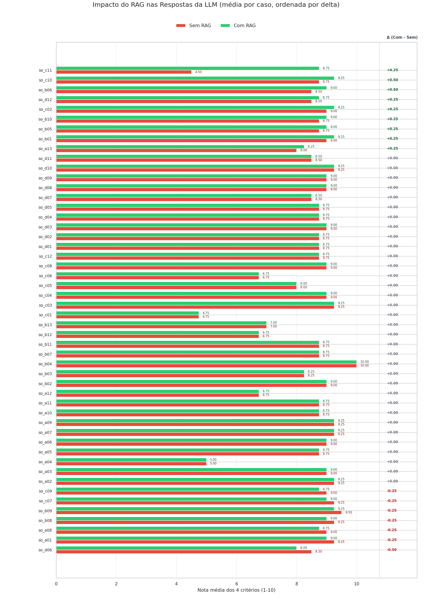

Média consolidada das notas (Com RAG vs Sem RAG):
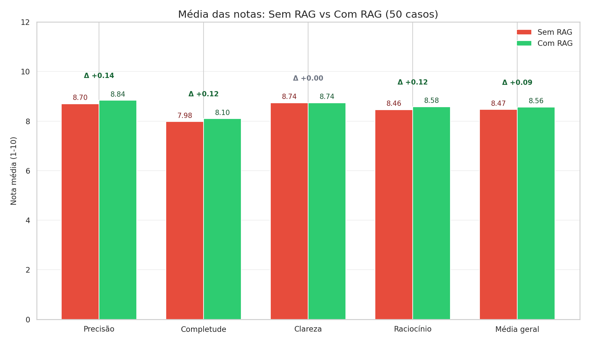

**Arquivos de diagnóstico** salvos em `debug_eval/`.
**Tabela completa de diagnósticos de ranking** em `debug_eval/rag_diagnostics.json`.
**Notas por caso (para regerar os gráficos sem repetir a suíte)** em `debug_eval/rag_results.json`.

10. Conclusão e Recomendações
-----------------------------
**Status final:** APROVADO

- Taxa de sucesso dos endpoints: 100.0%
- Taxa de sucesso do teste de carga: 100.0%
- Taxa de sucesso do frontend: 100.0%

Observações importantes:
- O juiz marcou **50 caso(s)** como 'deveriam diferir'.
- O RAG trouxe melhora média de +0.14 pontos em Precisão.
- **7 caso(s) com regressão** (RAG piorou).
- Filtro de similaridade: 544/600 chunks passaram (threshold=0.72). Self-match descartado: 56 chunk(s).
- Modelos bloqueados para visão: ['gpt-oss:120b', 'nemotron-3-ultra']. Ajuste via TEST_VISION_MODELS_BLOCKLIST.
- Juízes excluídos do benchmark e da avaliação: ['gpt-oss:120b', 'nemotron-3-ultra']. Ajuste via TEST_EVALUATOR_MODEL e TEST_SECONDARY_EVALUATOR.

11. Como reproduzir estes testes
-------------------------------
1. Ative o ambiente virtual e instale dependências.
2. Inicie os serviços: frontend, backend e llm_api.
3. Verifique se o arquivo de referência existe em `tests/`:
   - Sistemas Operacionais Modernos (Andrew S. Tanenbaum, Herbert Bos).pdf
4. Execute `python readme.py`.
5. Confira `README.md` e `images/`.
6. Diagnósticos em `debug_eval/`, incluindo `debug_eval/rag_diagnostics.json`.

**Avalie o projeto respondendo ao formulário abaixo:**
https://docs.google.com/forms/d/e/1FAIpQLSeU19fj5QZ4zc2Zz6vlycZPlL42yOoRo1VA6q9CLCPq7ftBeg/viewform?usp=sharing&ouid=105919124478207064388

<!-- TEST_RESULTS_END -->